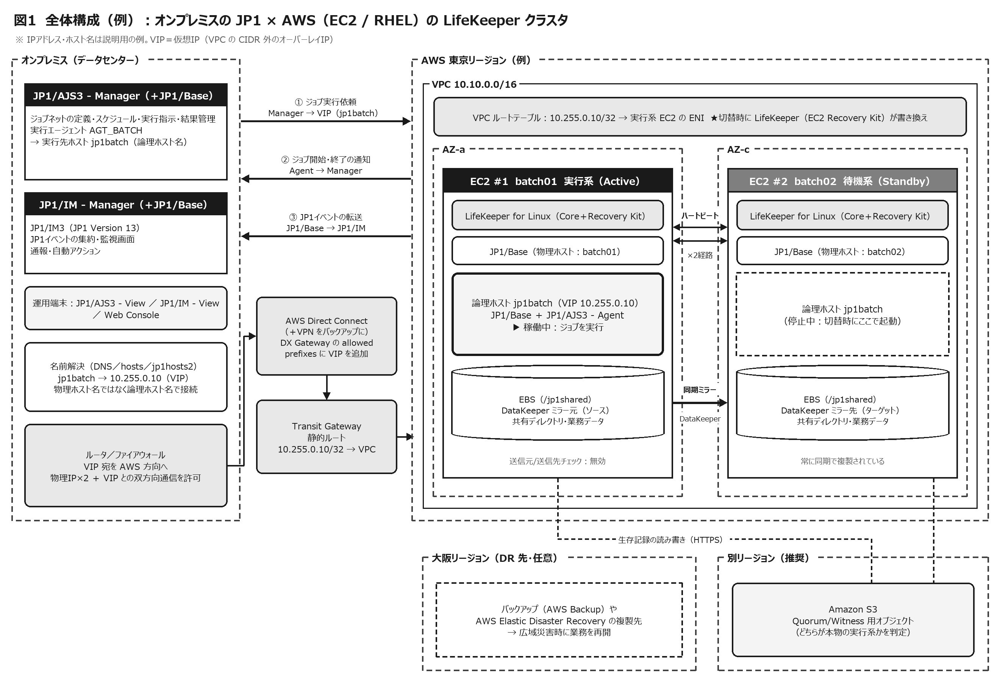
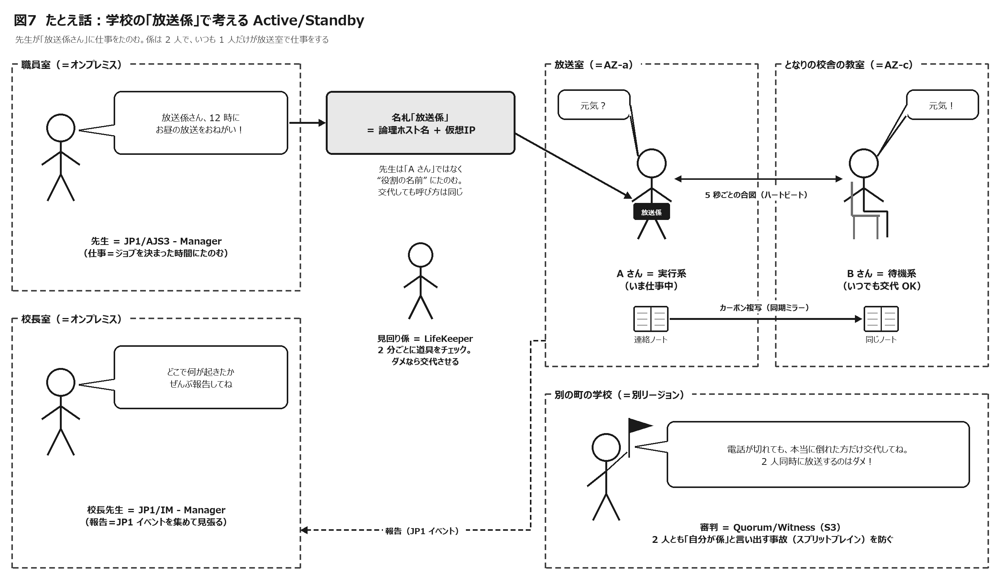
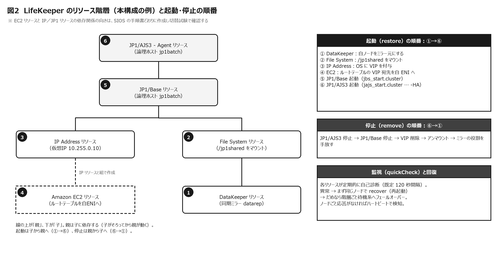
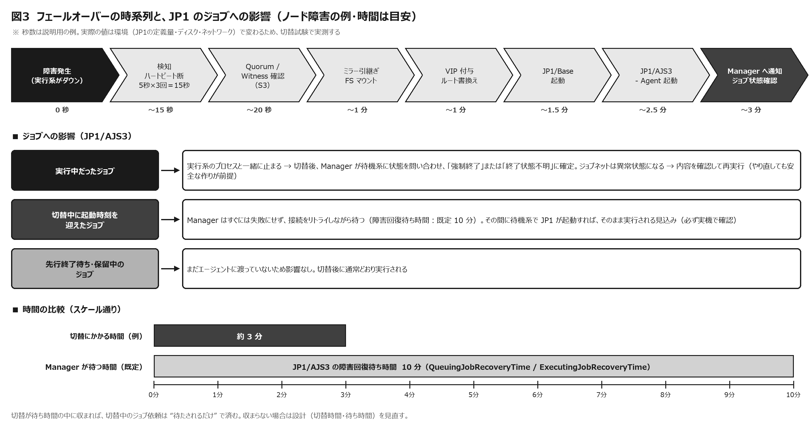
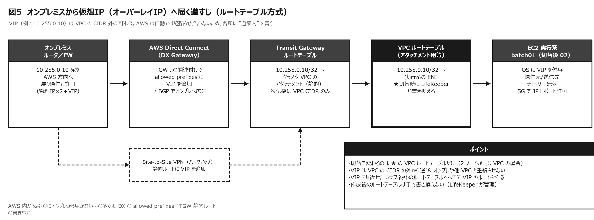
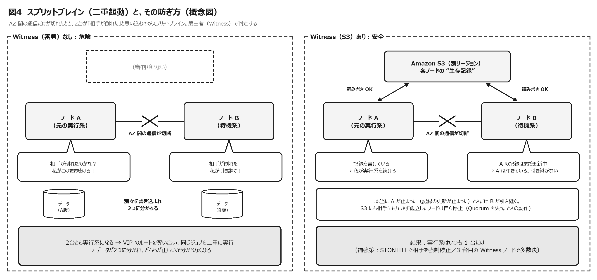
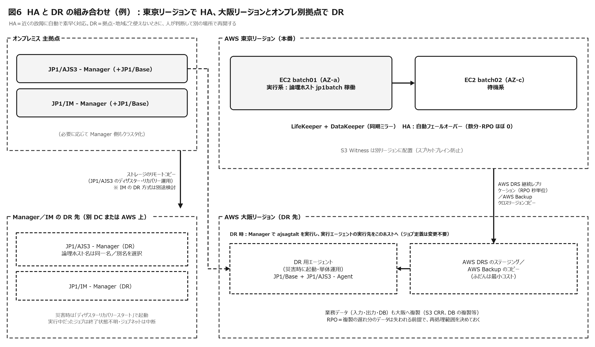

# EC2（RHEL）× LifeKeeper × JP1 バッチサーバ Active/Standby 構成 解説書

**しくみ（動作原理）・動作イメージ・設計の勘どころ・DR 戦略まで ― 小学生にもわかる「たとえ話」つき**

- 同じ内容の Excel 版：`LifeKeeper_JP1_ActiveStandby_DR解説.xlsx`（Meiryo UI・モノトーン。数式入りの試算シート、入力欄つきチェックリストを含みます）
- 図版：`images/` フォルダー（PNG）

| 項目 | 内容 |
|---|---|
| 文書の目的 | AWS の EC2（RHEL）上に置くバッチサーバを LifeKeeper で Active/Standby 化し、オンプレミスの JP1/AJS3 - Manager と JP1/IM - Manager から実行・監視する構成について、①しくみ（動作原理）、②切替のときに JP1 がどう動くか、③設計で決めておくべきこと、④DR（災害対策）の考え方を、歴史や背景も含めて 1 冊で理解できるようにまとめたものです。 |
| 想定する読者 | 基盤（インフラ）設計者、運用設計者、バッチ（アプリ）設計者、プロジェクト管理者。専門外の方にも伝わるよう、各所に「やさしく言うと（たとえ話）」を入れています。 |
| 前提とする構成（例） | ・AWS 東京リージョン（例）の 2 つのアベイラビリティーゾーン（AZ）に EC2（RHEL）を 1 台ずつ配置し、LifeKeeper for Linux でクラスタを構成 ・各 EC2 に JP1/Base と JP1/AJS3 - Agent（本資料では「JP1 エージェント」と呼びます）を導入し、JP1 の「論理ホスト」としてクラスタ化 ・オンプレミスに JP1/AJS3 - Manager と JP1/IM - Manager（JP1/IM3）を構築し、ジョブの実行指示と統合監視を行う ・オンプレミスと AWS は AWS Direct Connect（または Site-to-Site VPN）と Transit Gateway で接続（例） |
| 情報の基準日 | 2026 年 10 月 11 日時点で公開されている製品マニュアル・公式情報を確認して作成しました（主に LifeKeeper for Linux v10.1、JP1 Version 13（13-50）、AWS 公式ドキュメント）。数値・仕様・サポート範囲はバージョンや修正パッチで変わるため、採用するバージョンのマニュアルとサポート情報で必ず最終確認してください。 |
| 読み方 | 各シートは「やさしく言うと（たとえ話）」→「しくみ（原理）」→「設計・運用での注意」の順に読めるようにしています。急ぐ方は「01_全体像」の結論サマリーだけでも要点がつかめます。 |
| 記号の意味 | ★★★＝必ず検討（重要度 高）　★★＝できれば検討　★＝状況に応じて ▲注意＝事故につながりやすい点　※＝補足・前提　（要確認）＝バージョン・契約・環境で変わるため個別確認が必要な点 |
| 用語の表記 | 実行系＝Active（いま業務を動かしている側）、待機系＝Standby（交代要員）。LifeKeeper v10 では画面上の用語が変わっています（Template→Primary、Target→Standby、待機状態の表示 Standby→Passive など）。本資料では一般的な言葉を優先します。 |
| 版数 | 第 1.0 版（2026-10-11）初版 |

## 目次

- [1. この構成をひと目で](#sec01)
- [2. 小学生にもわかる「交代のしくみ」](#sec02)
- [3. どうしてこの仕組みが生まれたの？（歴史と背景）](#sec03)
- [4. まず押さえる基礎（可用性・RTO/RPO・HA/DR・冗長化の型）](#sec04)
- [5. Active/Standby とフェールオーバーの動作原理（LifeKeeper）](#sec05)
- [6. AWS で Active/Standby を成り立たせる工夫](#sec06)
- [7. 切替に伴う JP1 の動きと、必要な考慮](#sec07)
- [8. 障害シナリオ別の動作イメージ](#sec08)
- [9. 設計で決めるべき事項（重要度つき一覧）](#sec09)
- [10. DR（災害復旧）戦略](#sec10)
- [11. 試算（フェールオーバー所要時間・可用性）](#sec11)
- [12. 設計・構築・試験・運用のチェックリスト](#sec12)
- [13. 用語集](#sec13)
- [14. 参考情報（確認した公式資料など）](#sec14)

> **▲注意**　本資料は公開情報をもとにした設計検討用の解説です。製品の組み合わせ（OS のマイナーバージョン、JP1 と LifeKeeper の対応、AWS の機能）や、時間・既定値は、必ずベンダーのサポート情報と実機の切替試験で確認してください。

---

## 1. この構成をひと目で

オンプレミスの JP1/AJS3 - Manager が「いつ・どのジョブを・どこで動かすか」を決め、AWS 上のバッチサーバ（JP1 エージェント）に実行を依頼します。バッチサーバは 2 台ですが、いつも 1 台（実行系）だけが仕事をし、もう 1 台（待機系）は控えています。LifeKeeper が実行系を見張り、おかしくなったら待機系に「仕事一式」（データ・仮想IP・JP1 の論理ホスト）を引っ越しさせます。JP1/IM - Manager は、こうした出来事（ジョブの異常や切替）を JP1 イベントとして集め、運用者に知らせます。

### 1-1 登場人物（コンポーネント）一覧

| 場所 | コンポーネント | 役割 | クラスタでの扱い | やさしく言うと |
|---|---|---|---|---|
| オンプレミス | JP1/AJS3 - Manager（＋JP1/Base） | ジョブネットの定義・スケジュール・実行指示・実行結果の管理 | 本資料の主対象外（Manager 自身の冗長化・DR は別途検討。10 章参照） | 仕事（宿題）を配る先生 |
| オンプレミス | JP1/IM - Manager（JP1/IM3）（＋JP1/Base） | JP1 イベントの集約、監視画面（統合コンソール、統合オペレーション・ビューアー）、通報・自動アクション | 同上 | 学校中の報告を受ける校長先生 |
| オンプレミス | JP1/AJS3 - View、JP1/IM - View、Web Console | 運用者の操作・監視画面 | 物理ホストで動作。接続先は Manager | 職員室のモニター |
| 回線 | AWS Direct Connect／Site-to-Site VPN、Transit Gateway | オンプレミスと AWS をつなぐ。仮想IP（VIP）への経路を案内する | 回線そのものの冗長化（2 回線・バックアップ VPN）が必要 | 職員室と放送室をつなぐ電話線 |
| AWS | EC2 #1（AZ-a）／EC2 #2（AZ-c）RHEL | バッチを実行するサーバ | LifeKeeper が 1 台だけを実行系にする | 放送係の A さんと B さん |
| AWS | LifeKeeper for Linux（Core＋Recovery Kit） | 監視と切替の司令塔。リソース（ミラー・FS・IP・JP1）を決まった順番で起動・停止する | 両ノードに導入。同じ版・同じパッチにそろえる | 見回り係（交代の段取りも担当） |
| AWS | DataKeeper（LifeKeeper のデータレプリケーション機能） | 各ノードの EBS をネットワーク越しにブロック単位で同期ミラーする（共有ディスクの代わり） | 実行系→待機系へ同期で複製 | カーボン複写の連絡ノート |
| AWS | JP1/Base（物理ホスト） | 各 EC2 の OS・LifeKeeper ログの監視、JP1 イベントの送信 | 両ノードで常に起動 | 係の人それぞれの連絡帳 |
| AWS | JP1/Base＋JP1/AJS3 - Agent（論理ホスト） | ジョブを実際に実行する。論理ホスト名＋VIP＋共有ディレクトリの組で動く | 実行系だけで起動し、切替で移動する | 「放送係」という役割そのもの（名札） |
| AWS | VPC ルートテーブル／Recovery Kit for EC2 | VPC の外側のアドレス（オーバーレイIP）である VIP 宛ての通信を、実行系の ENI へ向ける | 切替時に LifeKeeper が書き換える | 「放送室はこちら」の案内板 |
| AWS（別リージョン推奨） | Amazon S3（Quorum/Witness 用オブジェクト） | 2 台のどちらが本物の実行系かを判定する材料（生存記録）を置く | 両ノードが読み書きする | 別の学校にいる審判 |

### 1-2 結論サマリー（最重要ポイント 12）

| No | ポイント | 理由・補足 | 詳しく |
|---|---|---|---|
| 1 | Active/Standby は「いつも 1 台だけが仕事、もう 1 台は控え」。LifeKeeper が見張り、ダメなら仕事一式を控えへ引っ越しさせる。 | バッチは「決まった時刻に 1 回だけ」が原則。2 台同時に動くと二重実行になるため、Active/Standby と相性が良い。 | 04, 05 |
| 2 | JP1 は「論理ホスト」でクラスタ化する。Manager は物理ホスト名ではなく論理ホスト名（＝VIP）宛てにジョブを依頼する。 | 切替後も宛先が変わらないので、Manager 側の定義を変えずに済む。 | 07 |
| 3 | 切替の瞬間に実行中だったジョブは「強制終了」または「終了状態不明」になり、ジョブネットは異常状態になる（自動で続きからは再開しない）。 | JP1/AJS3 運用ガイド（V13）10.2.2 の記載。ジョブは “やり直しても安全” に作り、再実行の判断手順を決めておく。 | 07, 08 |
| 4 | 切替中に起動時刻を迎えたジョブは、Manager がすぐには失敗にせず待つ（障害回復待ち時間：既定 10 分）。 | 切替がこの時間内に終われば “待たされるだけ” で済む見込み。実機の切替試験で必ず確認する。 | 07, 11 |
| 5 | AWS では L2 の IP 引継ぎ（GARP）が使えない。VPC の CIDR 外の VIP（オーバーレイIP）をルートテーブルで切り替える方式が基本。 | Recovery Kit for EC2 のルートテーブル方式。AZ をまたいだ切替ができる。 | 06 |
| 6 | オンプレから VIP に届かせるには、Transit Gateway の静的ルートと Direct Connect の allowed prefixes（VPN なら静的ルート）が必要。 | VPC の CIDR 外のアドレスは自動では広告されない。「AWS 内からは届くのにオンプレから届かない」の典型原因。 | 06 |
| 7 | AWS には AZ をまたぐ共有ディスクがない → DataKeeper で同期ミラー。JP1/AJS 用 Recovery Kit は同期レプリケーションが条件。 | NFS（EFS 等）は JP1 の共有ディスクとして使えない（JP1/AJS3 マニュアル）。NAS ベースの FS 階層も Recovery Kit の対象外。 | 06 |
| 8 | スプリットブレイン（2 台とも実行系）を防ぐため、Quorum/Witness（S3 を別リージョンに置く storage モード等）や STONITH を必ず設計する。 | AWS では SCSI 予約によるフェンシングが使えない。SIOS も Quorum/Witness か STONITH を推奨。 | 06 |
| 9 | HA（AZ までの故障に自動対応）と DR（リージョン・拠点ごとの被災に人の判断で対応）は別物。 | DR は「Manager（オンプレ）・回線・Agent（AWS）・業務データ・監視」をセットで考える。 | 10 |
| 10 | OS は JP1 と LifeKeeper の両方のサポート範囲が重なる版を選ぶ。 | 2026 年 10 月時点：LifeKeeper v10.1 は RHEL 9.8／10.2 を認定。JP1 V13 は公開情報で RHEL 10 対応を確認できず → RHEL 9 系が現実的（マイナー版まで要確認）。 | 09 |
| 11 | 監視は「論理ホスト（業務）」「物理ホスト 2 台（基盤）」「クラスタ全体（どちらが実行系か）」の 3 つの視点で行う。 | 急に止まった実行系は自分では報告できない。待機系側で LifeKeeper のログを JP1/Base のログファイルトラップで拾う。 | 07 |
| 12 | 年 1 回以上の切替試験・DR 訓練で、切替時間とジョブへの影響を実測し、手順書を更新する。 | 設計値（秒数・待ち時間）は環境で変わる。実測こそが唯一の根拠になる。 | 08, 12 |

### 1-3 この資料で答える問い

| 問い | 答えのありか | ひとことで |
|---|---|---|
| Active/Standby とは？ フェールオーバー構成とは？ | 04_基礎用語、05_動作原理 | 1 台が仕事・1 台が控え。故障したら自動で交代（フェールオーバー）するしくみ |
| 切替のとき JP1（ジョブ・監視）はどう動く？ | 07_JP1連携、08_切替シナリオ | 実行中ジョブは強制終了等 → 再実行。新しいジョブは待機 → 切替後に実行 |
| AWS で何を工夫しないといけない？ | 06_AWS実装 | 仮想IP（ルートテーブル）、データ（DataKeeper）、二重起動の防止（Witness） |
| 設計で何を決めておく？ | 09_設計考慮事項、12_チェックリスト | 名前解決、通信、ジョブの冪等性、監視、試験、運用手順 |
| DR はどう考える？ | 10_DR戦略 | HA と分けて考え、Manager・回線・データも含めて、人が判断して発動する |
| そもそもなぜこんな仕組みがある？ | 03_歴史と背景 | 機械は必ず壊れる。でも業務は止めたくない、という長年の工夫の結晶 |

---

## 2. 小学生にもわかる「交代のしくみ」

むずかしい言葉はいったん忘れて、学校の「放送係」で考えてみましょう。ここで出てくるたとえは、あとのシートでも何度も使います。

### 2-1 お話：放送係の交代

| 場面 | お話（たとえ） | 本当は何のこと？ |
|---|---|---|
| 1 | 先生は職員室にいて、毎日決まった時間に「お昼の放送をしてね」「明日のプリントを印刷してね」と仕事をたのみます。 | 先生＝JP1/AJS3 - Manager（オンプレミス）。仕事＝ジョブ。決まった時間＝スケジュール。 |
| 2 | 放送係は 2 人。A さんは放送室で仕事中、B さんはとなりの校舎の教室で待っています。 | 2 台の EC2。A さん＝実行系（AZ-a）、B さん＝待機系（AZ-c）。別の校舎＝別のアベイラビリティーゾーン。 |
| 3 | 先生は「A さん」ではなく「放送係さん」と “役割の名前” でたのみます。名札を付けている人が、そのときの放送係です。 | 論理ホスト名（jp1batch）と仮想IP（VIP）。交代しても先生（Manager）の呼び方（設定）は変わらない。 |
| 4 | 放送係の連絡ノートはカーボン紙で 2 冊同時に書かれます。A さんが書いたことは、その瞬間に B さんのノートにも写ります。 | DataKeeper の同期ミラー。データは 2 か所に同時に保存される（RPO ほぼ 0）。 |
| 5 | A さんと B さんは 5 秒ごとに「元気？」「元気！」と合図します。3 回続けて返事がない（15 秒）と「何かあった！」と判断します。 | ハートビート（LCMHBEATTIME＝5 秒 × LCMNUMHBEATS＝3 回）。合図の電話線は 2 本以上用意する（コミュニケーションパスの冗長化）。 |
| 6 | 見回り係は、A さんが道具をちゃんと使えているかを 2 分ごとに見ます。道具が壊れたら、まずその場で直そうとし、だめなら B さんに交代させます。 | LifeKeeper の quickCheck（既定 120 秒間隔）。その場で直す＝ローカルリカバリー、交代＝フェールオーバー。 |
| 7 | 交代の手順は、①ノートを受け取る ②名札を付ける ③「放送室はこっち」の案内板を書き換える ④道具を準備する ⑤先生に「交代しました」と知らせる、の順番です。 | ①ミラー引継ぎ・マウント ②VIP 付与 ③ルートテーブル書換え ④JP1/Base→JP1/AJS3 起動 ⑤Manager へ通知。順番はリソース階層で決まる。 |
| 8 | 交代の瞬間に途中だった仕事は「途中で止まった」か「どうなったか分からない」扱いになります。先生が確かめて「もう一回やって」とたのみます。 | 実行中のジョブは「強制終了」または「終了状態不明」。ジョブネットは異常状態になり、再実行が必要。 |
| 9 | だから仕事は「2 回やっても困らない」ように作っておくのが大事です。 | 冪等性（べきとうせい）。出力の作り直し、二重登録の防止、再開ポイントの設計。 |
| 10 | 交代中に先生が新しい仕事をたのもうとしても、先生はすぐにはあきらめず、しばらく（10 分くらい）呼びかけ続けます。その間に交代が終われば B さんが受け取ります。 | JP1/AJS3 の障害回復待ち時間（既定 10 分）と通信リトライ。切替時間がこの中に収まるように設計する。 |
| 11 | いちばん困るのは、A さんと B さんの間の電話だけが切れたとき。2 人とも「相手が倒れた！」と思い、2 人とも放送を始めてしまいます。 | スプリットブレイン。2 台とも実行系になり、VIP の奪い合い・二重実行・データの分裂が起きる。 |
| 12 | そこで、別の学校にいる審判に「どっちが係？」を確かめ、認められた 1 人だけが仕事をするルールにします。 | Quorum/Witness（S3 を別リージョンに置く等）、STONITH（相手を強制停止）。 |
| 13 | 校長先生には「交代しました」「仕事が途中で止まりました」と必ず報告が届くようにします。A さんが急に倒れたら A さんは報告できないので、B さんや見回り係が報告します。 | JP1/IM へのイベント通知。実行系が急に止まったときは、待機系の JP1/Base が LifeKeeper のログを拾って通知する設計が大事。 |
| 14 | 学校全体が使えないとき（大地震など）は、別の町の学校で仕事を再開する準備が必要です。先生や電話線が無事かどうかも一緒に考えないと、係だけ引っ越しても仕事は来ません。 | DR（災害復旧）。別リージョンや別拠点で再開する。Manager（オンプレ）・回線・業務データも含めて計画する。 |

### 2-2 ことばの対応表

| 本当の言葉 | たとえ | ひとことで言うと |
|---|---|---|
| アクティブ／スタンバイ（実行系／待機系） | 仕事中の係／待機中の係 | いつも 1 人だけが仕事をする |
| フェールオーバー | 急な交代 | 故障したら自動で控えに交代 |
| スイッチオーバー | 予定どおりの交代 | 点検のための計画的な交代 |
| フェールバック（スイッチバック） | 元の係に戻す | 直ったら戻すかどうかは、あらかじめ決めておく |
| ハートビート | 「元気？」の合図 | 5 秒ごと × 3 回で判断 |
| 論理ホスト名／仮想IP | 「放送係」という名札 | 人ではなく役割に話しかける |
| 共有ディスク／DataKeeper | カーボン複写のノート | データは 2 か所に同時に保存 |
| quickCheck | 見回り | 道具がちゃんと動くかを定期的にチェック |
| スプリットブレイン | 2 人とも自分が係だと言い張る | いちばんこわい事故 |
| Quorum／Witness | 審判 | 多数決や第三者で本物を決める |
| STONITH | 強制退場 | 怪しい方の電源を切って安全にする |
| RTO／RPO | 何分で再開する？／ノートの何ページまで残る？ | 復旧の “時間” と “データ” の目標 |
| HA／DR | 隣の校舎で交代／別の町の学校で再開 | 近くの故障への対策と、広い範囲の災害への対策 |
| バックアップ | 昔のノートの写真 | まちがいや破損から元に戻すため |
| JP1/AJS3 - Manager | 先生 | 仕事（ジョブ）を配る |
| JP1/AJS3 - Agent | 係の人 | 仕事をする |
| JP1/IM - Manager | 校長先生 | 報告を集めて見張る |

### 2-3 ここだけ覚えれば OK

> **ポイント**　① いつも 1 人だけが仕事、1 人は控え。おかしくなったら見回り係（LifeKeeper）が交代させる。
> ② 交代の瞬間に途中だった仕事はやり直しになる。だから「やり直しても困らない仕事」にしておく。
> ③「2 人とも係」を防ぐ審判（Quorum/Witness）と、学校ごと使えないとき（DR）の準備を忘れない。

---

## 3. どうしてこの仕組みが生まれたの？（歴史と背景）

> **やさしく言うと**　「機械は必ずいつか壊れる。でも、みんなの生活を支える仕事は止めたくない」。この “むじゅん” をとくために、昔から「2 台目を用意して、こわれたら交代する」工夫が続けられてきました。大きなコンピュータの時代 → 小さなサーバをたくさん使う時代 → クラウドの時代と、形を変えながら受けつがれています。

### 3-1 必要になった経緯（4 つの波）

| 時代 | 世の中の変化 | 困ったこと | 生まれた解決策 |
|---|---|---|---|
| 1960〜80 年代 | 銀行・電話・交通などの業務を、1 台の大型汎用機（メインフレーム）に集める | 1 台が止まると会社全体（社会）が止まる | 部品の二重化、止まらない専用機（フォールトトレラント機：1976 年 Tandem NonStop など）、複数台を束ねるクラスタ（1984 年 VAXcluster など） |
| 1990 年代 | オープン化・ダウンサイジング。安い UNIX／PC サーバへ移行 | 1 台あたりの信頼性が低い。メインフレームのような運用（ジョブの自動実行・監視）の仕組みがない | ソフトウェアで交代させる HA クラスタ（1991 年 HACMP、1992 年 LifeKeeper、1997 年 MSCS など）、オープン系のジョブ管理（1994 年 JP1） |
| 2000〜2010 年代 | 24 時間 365 日の業務。大災害の教訓（2001 年 米同時多発テロ、2011 年 東日本大震災） | サーバの故障だけでなく、建物や地域ごと使えなくなる | BCP（事業継続計画）と DR、遠隔地へのデータ複製、共有ディスクを使わないレプリケーション型クラスタ |
| 2010 年代後半〜現在 | クラウド（AWS など）へ基幹系も移行 | 共有ディスクや L2 の IP 引継ぎがない。AZ・リージョンという新しい「壊れ方の単位」 | AZ 分散（マルチ AZ）、クラウド対応の切替方式（ルートテーブル・DNS）、S3 を使った Quorum/Witness、クラウドの DR サービス |

### 3-2 年表

| 年 | 出来事 | この構成との関係 |
|---|---|---|
| 1976 | Tandem Computers が NonStop を出荷。部品をすべて二重化し「止まらない」ことを目指した | 「止めない」発想の原点。ただし非常に高価 |
| 1984 | DEC が VAXcluster を提供。複数台を 1 つのシステムのように運用 | 「クラスタ」の考え方が広まる |
| 1991 | IBM が AIX 向け HA クラスタ HACMP を提供 | UNIX のソフトウェア HA クラスタの代表例 |
| 1992 | AT&T ベル研究所で LifeKeeper が誕生（電話網のサーバを止めないため） | LifeKeeper の起源 |
| 1994 | 日立が JP1 を発売。メインフレームで培った知見を生かした、オープン系の分散型ジョブ管理 | Manager／Agent 型でジョブを配る仕組みの起源 |
| 1997 頃 | LifeKeeper の事業が NCR へ。Microsoft Cluster Server（MSCS）が登場 | HA クラスタが一般企業へ普及 |
| 1999 | NCR からのスピンオフで SteelEye Technology が設立され、LifeKeeper を継承 | Linux 版の展開が進む |
| 2001 | 米国同時多発テロ。BCP／DR の重要性が世界的に認識される | 「建物ごと失う」前提の設計へ |
| 2006 | サイオス（日本）が SteelEye を買収し、SIOS Technology Corp. に。AWS が EC2 の提供を開始 | LifeKeeper が日本企業の製品に／クラウドの始まり |
| 2008 | EC2 にアベイラビリティーゾーン（AZ）と Elastic IP が登場 | クラウドでも「別の建物」に分けて冗長化できるように |
| 2011 | AWS 東京リージョン開設（3 月 2 日）。東日本大震災（3 月 11 日） | 国内で DR／BCP とクラウド活用が加速 |
| 2018・2021 | AWS 大阪ローカルリージョン（2018）→ 大阪リージョン（2021） | 国内 2 リージョンでの DR が現実的に |
| 2021 | EC2 単体インスタンスの SLA が 90％→99.5％に。複数 AZ 構成は 99.99％ | 「1 台より複数 AZ」が可用性の公式な目安に |
| 2023 | JP1 Version 13 を発売（オブザーバビリティ強化、JP1/IM3） | 本構成で使う最新世代 |
| 2024 | JP1 が誕生 30 周年 | 長く使われてきた運用基盤 |
| 2025 | JP1 Version 13（13-50）リリース（10 月）。LifeKeeper v10 発表（12 月）：Recovery Kit for JP1/AJS の正式サポート、Web 管理コンソール（LKWMC）の標準化、Transit Gateway 用 Generic ARK の同梱 | JP1 を LifeKeeper で守る公式キットが登場 |
| 2026 | LifeKeeper for Linux v10.1 リリース（7 月 29 日）。RHEL 9.8／10.2 を認定（8 月）、EC2・Route 53 の Recovery Kit で AWS プロファイルの指定が可能に | 本資料の基準バージョン |

※ 年代は公開情報（各社の公式情報・百科事典等）にもとづく目安です。製品の誕生年などは資料によって 1 年程度の差がある場合があります。

### 3-3 なぜ「バッチサーバ」に Active/Standby なのか

バッチ処理（夜間の集計、ファイル連携、帳票作成など）は、「決まった時刻に、決まった順番で、1 回だけ」実行するのが原則です。2 台で同時に動かす Active/Active にすると、同じジョブが二重に動いたり、同じファイルを取り合ったりする危険があります。そのため、「いつも 1 台だけが実行し、壊れたら控えが引き継ぐ」Active/Standby が相性の良い形です。一方、Web サーバのように同じ処理を何台並べても困らない（状態を持たない）ものは、Active/Active（負荷分散）が向いています。

> **やさしく言うと**　給食当番は「配る人が 2 人いると同じ子に 2 回配ってしまう」ので、当番は 1 人、休んだら代わりの子が交代、というルールにするのと同じです。

### 3-4 クラウドなら HA クラスタソフトは要らない？

AWS には EC2 の自動復旧（Auto Recovery）や Auto Scaling があります。しかし、①アプリケーション（JP1）の異常までは見ていない、②自動復旧は同じ AZ の中での復旧で、AZ 全体の障害には対応しない、③「1 回だけ実行」に必要な状態（ジョブの実行状況・データ）を別のサーバへ引き継がない、という違いがあります。LifeKeeper は、アプリ単位の監視、AZ をまたいだ切替、データの同期、二重起動の防止を一体で提供するため、ジョブ管理のように「状態を持つ 1 台構成の業務」では今も選ばれています。

> **▲注意**　SIOS は、Recovery Kit for EC2 と EC2 の自動復旧（Auto Recovery）を併用すると LifeKeeper の回復処理と競合するおそれがあるとして、併用を推奨していません（09_設計考慮事項 参照）。

### 3-5 本構成に至る流れ（まとめ）

1. メインフレームの「止めない運用」とジョブ管理のノウハウが、1990 年代にオープン系へ移った（JP1 の誕生）。
2. 安いサーバを 2 台並べてソフトウェアで交代させる HA クラスタが普及した（LifeKeeper の誕生と普及）。
3. 大災害を経て、「サーバの故障」だけでなく「拠点・地域ごとの被災」に備える DR が必須になった。
4. クラウド移行で共有ディスクや IP 引継ぎの前提が崩れ、ルートテーブルの切替・データレプリケーション・クラウド上の Witness といった新しい部品が生まれた。
5. 2025〜2026 年、LifeKeeper v10 で JP1/AJS 用の Recovery Kit が正式に提供され、JP1 と LifeKeeper を AWS 上で組み合わせる構成を、より標準的な形で組めるようになった。

---

## 4. まず押さえる基礎（可用性・RTO/RPO・HA/DR・冗長化の型）

### 4-1 可用性と「9 の数」

可用性とは「使いたいときに使える割合」です。計算式は「稼働時間 ÷（稼働時間＋停止時間）」で、平均故障間隔（MTBF）と平均修理時間（MTTR）を使って「MTBF ÷（MTBF＋MTTR）」とも表します。99.9％（スリーナイン）のように 9 の数で表すことが多く、9 が 1 つ増えるごとに、許される停止時間は 10 分の 1 になります。下の表は数式で計算しています（可用性の値を書き換えると再計算されます）。

> **やさしく言うと**　「1 年 365 日のうち、どれだけお店を開けていられるか」。99.9％でも、1 年で 8 時間あまりはお店が閉まってもいい計算です。

| 可用性 | 年間の停止許容（時間） | 年間の停止許容（分） | 月間（30 日）の停止許容（分） | イメージ |
|---|---|---|---|---|
| 99.000% | 87.60 | 5,256.0 | 432.0 | ツーナイン。一般的なサーバ 1 台の目安 |
| 99.500% | 43.80 | 2,628.0 | 216.0 | EC2 単体インスタンスの SLA 水準（月間） |
| 99.900% | 8.76 | 525.6 | 43.2 | スリーナイン。多くの社内システムの目標 |
| 99.950% | 4.38 | 262.8 | 21.6 | スリーナインファイブ |
| 99.990% | 0.88 | 52.6 | 4.3 | フォーナイン。EC2 を複数 AZ に置いた場合の SLA 水準（月間） |
| 99.999% | 0.09 | 5.3 | 0.4 | ファイブナイン。通信・金融の基幹級 |

（計算式：年間の停止許容（時間）＝（1 − 可用性）× 365 × 24、月間（分）＝（1 − 可用性）× 30 × 24 × 60）

※ AWS の Amazon Compute SLA：単一の EC2 インスタンスは月間稼働率 99.5％、同一リージョンの 2 つ以上の AZ に配置した場合はリージョンレベルで 99.99％。いずれも返金（サービスクレジット）の基準であり、アプリケーションの可用性を保証するものではありません。

### 4-2 RTO と RPO（復旧の “時間” と “データ” の目標）

| 指標 | 意味 | やさしく言うと | 本構成の HA での目安 | 本構成の DR での目安 |
|---|---|---|---|---|
| RTO（目標復旧時間） | 障害が起きてから業務を再開するまでの目標時間 | 何分でお店を再開する？ | 数分（検知 15 秒＋起動処理。実測で確定） | 数十分〜数時間（DR の方式と手順の自動化度で決まる） |
| RPO（目標復旧時点） | どの時点までのデータを取り戻すか（許容するデータ損失の幅） | ノートの何ページ目まで残っていれば OK？ | ほぼ 0（同期ミラー）。ただし実行中だったジョブはやり直し | 秒〜24 時間（複製・バックアップの方式と間隔で決まる） |
| RLO（目標復旧レベル） | どのレベル（機能・性能）まで戻すか | 全部の放送？ お昼の放送だけ？ | 全機能 | 優先度の高いジョブだけ、など段階的に |

### 4-3 HA・DR・バックアップの違い

| 項目 | HA（高可用性） | DR（災害復旧） | バックアップ |
|---|---|---|---|
| 守る対象 | サーバやプロセスの故障、AZ の障害 | リージョン・データセンターなど拠点ごとの被災 | データの消失・破損（誤操作、ソフトの不具合、ランサムウェア） |
| 典型的な方式 | 同じ地域に 2 台。自動で切替（本構成の LifeKeeper） | 離れた地域に複製し、そこで再開 | 過去の時点のコピーを世代管理して保管 |
| 切替の判断 | 自動（数秒〜数分で判断） | 人が判断（誤発動のコストが大きい） | 人が判断（どの時点に戻すか） |
| RTO／RPO | 数分／ほぼ 0 | 数十分〜数時間／秒〜時間 | 数時間〜／バックアップの時点 |
| 本構成での実装 | LifeKeeper＋DataKeeper（東京の 2 つの AZ） | 大阪リージョン等への複製、Manager 側の DR（10 章） | EBS スナップショット、AWS Backup（別リージョン・別アカウントへのコピー） |
| やさしく言うと | 隣の校舎で交代 | 別の町の学校で再開 | 昔のノートの写真をとっておく |

> **▲注意**　HA や DR のレプリケーションは、「壊れたデータ」や「誤って消したこと」も、そのまま相手にコピーします。HA・DR があっても、バックアップは別に必要です。

### 4-4 冗長化の型

| 型 | しくみ | 長所 | 短所 | 本構成での位置づけ |
|---|---|---|---|---|
| Active/Standby（片方向スタンバイ） | 1 台が処理し、1 台は待機。障害時に待機系が引き継ぐ | 二重実行が起きにくく、データの整合性を保ちやすい | 待機系の資源がふだん遊ぶ（コスト） | 採用。バッチ（1 回だけ実行）に最適 |
| Active/Active（負荷分散型） | 複数台が同時に処理。1 台が壊れても残りで続ける | 資源を無駄にしない。切替の時間がほぼない | 状態を持つ処理では、排他・整合の工夫が必要 | バッチでは二重実行の危険があり不向き（ジョブ単位で分ける設計なら可） |
| 相互スタンバイ | 業務 X はノード A、業務 Y はノード B で動かし、互いに相手の待機系になる | 2 台とも使える | 障害時は 1 台に 2 業務が載るため、性能の余裕が必要 | 将来バッチを 2 系統に分ける場合の選択肢 |
| N＋1／N：M | N 台の実行系に対して 1 台（M 台）の待機系を共有する | 待機系のコストを分散できる | 同時に複数が壊れると弱い。構成が複雑 | 対象外（小規模のため） |
| コールドスタンバイ | 待機系は停止、またはソフト未起動。障害時に起動・設定する | 安い | 切替に時間がかかる（数十分〜） | DR のバックアップ方式に近い |
| ウォームスタンバイ | 待機系は起動済み。アプリは停止しており、切替時に起動する | 切替が比較的速い | アプリの起動時間はかかる | 本構成の待機系（OS・LifeKeeper は起動済み、JP1 の論理ホストは停止、データは同期済み）はこの形に近い |
| ホットスタンバイ | 待機系もアプリまで起動し、データも同期済み | 最速 | 高価・複雑 | ― |

※ コールド／ウォーム／ホットの定義は、文献やベンダーによって幅があります。会話では「何が起動済みで、何を切替時に起動するのか」を具体的に言うと誤解がありません。

### 4-5 切替に関する言葉

| 用語 | 意味 | LifeKeeper での呼び方・動き（本構成） |
|---|---|---|
| フェールオーバー | 障害時の自動切替 | 障害を検知し、ローカルリカバリーで直らなければ（またはノードが応答しなければ）、リソース階層ごと待機系で起動する |
| スイッチオーバー | 計画的な手動切替（メンテナンス等） | 管理画面（LKWMC）やコマンドで、リソース階層を待機系で「In Service」にする。実行系では先に停止（remove）が行われる |
| フェールバック／スイッチバック | 元のノードへ戻すこと | Switchback Type＝intelligent（既定：自動では戻らず、管理者が戻す）／automatic（元のノードの復帰時に自動で戻る）。データレプリケーションを使う場合は intelligent が前提とされる資料あり（要確認） |
| ローカルリカバリー | 同じノードの中で再起動して直すこと | quickCheck が異常を検知すると recover を実行。JP1/AJS 用 Recovery Kit では、起動（restore）と同じ手順で再起動を試みる |
| ハートビート | 生存確認の合図 | コミュニケーションパス（TCP）で送受信。既定は 5 秒間隔（LCMHBEATTIME）× 3 回（LCMNUMHBEATS）＝15 秒でそのパスを断と判定。冗長なパスも含め全パスが断のときに、ノード障害として扱う |
| quickCheck | リソースごとの定期監視 | 既定で 120 秒間隔（LKCHECKINTERVAL）。JP1/AJS 用 Recovery Kit は JP1 の状態確認コマンドで監視する |
| スプリットブレイン | 2 台とも実行系として動いてしまう状態 | 通信だけが切れたときに起きやすい。Quorum/Witness・STONITH で防ぐ |
| フェンシング | 怪しいノードを隔離し、データを守る仕組み | オンプレの共有ディスクでは SCSI 予約が定番。AWS では使えないため、Quorum/Witness・STONITH を使う |
| Quorum（クォーラム） | 多数派（または判定条件を満たす側）を正とみなす仕組み | QUORUM_MODE＝majority（既定）／tcp_remote／storage／none。Quorum を失ったノードは QUORUM_LOSS_ACTION（既定 fastkill）で退く |
| Witness（ウィットネス） | 第三者による生存確認 | WITNESS_MODE＝remote_verify（既定）／storage／none。相手が本当に止まったかを第三者の情報で確かめてから引き継ぐ |
| STONITH | “Shoot The Other Node In The Head”。相手ノードを強制停止して確実に排除する | AWS では AWS CLI（停止 API や SSM 経由の停止）を使うスクリプトで実現する（SIOS の手順あり） |

### 4-6 データの持ち方：共有ディスク型とレプリケーション型

| 方式 | しくみ | オンプレミスでは | AWS では | 本構成 |
|---|---|---|---|---|
| 共有ディスク型（SAN） | 1 つのディスクを 2 台につなぎ、実行系だけがマウントして使う | HA クラスタの定番。SCSI 予約で二重書込みを防ぐ | AZ をまたいで共有できるブロックストレージはない（EBS Multi-Attach は同じ AZ 内・対応ボリュームのみ） | 不採用 |
| データレプリケーション型（シェアードナッシング） | 各ノードが自分のディスクを持ち、ネットワーク越しに複製する | 遠隔地 DR でも使われる | DataKeeper で AZ 間をブロック単位で同期ミラー | 採用（同期） |
| NAS／NFS 型 | ネットワーク越しのファイル共有を使う | アプリによっては可 | Amazon EFS、Amazon FSx など | JP1 の共有ディスクには使えない（JP1/AJS3 マニュアル）。業務データの置き場としては検討可 |

### 4-7 JP1 の「論理ホスト」とは

JP1 には、サーバそのもの（物理ホスト）で動く環境とは別に、「論理ホスト」という “仮想的なサーバ” で動く環境を作る仕組みがあります。論理ホストは「論理ホスト名＋論理 IP アドレス（本構成では VIP）＋共有ディスク上の設定・データ」の組です。クラスタソフトは、この組を実行系で起動し、障害時には待機系で起動し直します。Manager などの相手からは、いつも同じ名前・同じアドレスに見えるので、どちらのサーバで動いていても同じように通信できます。

> **やさしく言うと**　論理ホストは「放送係」という役割の名札です。名札を付けた人がそのときの係で、先生は名札の名前で呼びます。

---

## 5. Active/Standby とフェールオーバーの動作原理（LifeKeeper）

> **やさしく言うと**　見回り係（LifeKeeper）は、①道具（JP1 など）が動いているか、②相手の係が元気か、を見張っています。おかしければ、決められた順番どおりに道具を片付け・準備して、交代を進めます。

### 5-1 LifeKeeper の部品

| 部品 | 役割 | やさしく言うと |
|---|---|---|
| LifeKeeper Core | 監視と制御の本体。リソースの状態を管理し、起動・停止・切替を実行する | 見回り係の頭脳 |
| コミュニケーションパス | ノード間でハートビートや状態をやり取りする通信路（TCP）。2 経路以上が推奨 | 「元気？」の電話線 |
| リソース | 守る対象（ミラー、ファイルシステム、IP、JP1 など）を LifeKeeper 上で表したもの | 守る道具 1 つ 1 つ |
| リソース階層 | リソースの依存関係のツリー。子が先に起動し、親が後に起動する（停止は逆） | 道具を出す順番表 |
| Recovery Kit（ARK） | リソースの種類ごとの起動（restore）・停止（remove）・監視（quickCheck）・回復（recover）の処理集。JP1/AJS 用、EC2 用、IP 用、ファイルシステム用、DataKeeper など | 道具ごとの取扱説明書 |
| LKWMC／lkcli | Web 管理コンソール（v10 で Core に同梱され、既定の GUI に）／コマンドラインツール | 操作パネル |
| Quorum/Witness・STONITH | 二重起動（スプリットブレイン）を防ぐ仕組み | 審判と強制退場 |

### 5-2 リソース階層（本構成の例）と起動・停止の順番

| 順 | リソース | 起動（restore）でやること | 停止（remove）でやること | 監視（quickCheck） |
|---|---|---|---|---|
| ① | DataKeeper（同期ミラー） | 自ノードをミラー元（ソース）にする | ミラー元の役割を手放す | ミラーの状態 |
| ② | File System（/jp1shared） | ミラーのデバイスをマウントする（ジャーナルで整合性を回復） | アンマウントする | マウントの状態 |
| ③ | IP Address（VIP 10.255.0.10） | OS に VIP を付与する | VIP を削除する | VIP の存在・疎通 |
| ④ | Amazon EC2（ルートテーブル方式） | VPC ルートテーブルの VIP 宛先を自ノードの ENI に書き換える（ReplaceRoute） | （次に起動するノード側で書き換える） | ルートの状態（詳細は製品仕様で確認） |
| ⑤ | JP1/Base（論理ホスト jp1batch） | /etc/opt/jp1base/jbs_start.cluster jp1batch | /etc/opt/jp1base/jbs_stop.cluster jp1batch | /opt/jp1base/bin/jbs_spmd_status -h jp1batch、/opt/jp1base/bin/jevstat jp1batch |
| ⑥ | JP1/AJS3 - Agent（論理ホスト jp1batch） | /etc/opt/jp1ajs2/jajs_start.cluster jp1batch -HA | /etc/opt/jp1ajs2/jajs_stop.cluster jp1batch | /opt/jp1ajs2/bin/jajs_spmd_status -h jp1batch |

※ コマンドは SIOS「Recovery Kit for JP1/AJS Processing Overview」（v10.1）の記載にもとづく例です（論理ホスト名を当てはめています）。強制停止には jbs_killall.cluster／jajs_killall.cluster が使われます。各処理のタイムアウト（Restore Timeout、Remove Timeout、Forced Termination Timeout、QuickCheck Timeout、Retry Interval）は Recovery Kit のプロパティで調整します。

> **▲注意**　③IP・④EC2・⑤JP1/Base の依存関係（どれが親か）は、SIOS の手順書どおりに作成し、切替試験で「ルートの書換え → JP1 の起動」の順になっていることを確認してください。JP1 が先に起動して Manager へ通知しても、ルートが古いノードを向いていると通信できません。

### 5-3 監視と判断のしくみ

| 段階 | 何を見ているか | 異常のときの動き | 既定値・目安 |
|---|---|---|---|
| アプリ・プロセスの監視 | 各リソースの quickCheck。JP1 は jbs_spmd_status／jevstat／jajs_spmd_status の結果 | recover（同じノードで再起動）→ 直らなければ階層ごと待機系へフェールオーバー | 間隔：LKCHECKINTERVAL＝120 秒（既定） |
| ノードの監視 | すべてのコミュニケーションパスのハートビート | 全パスが断 → 相手ノードの障害と判断 → Quorum/Witness で確認 → 待機系で起動 | 5 秒 × 3 回＝15 秒で 1 パスを断と判定 |
| 二重起動の防止 | Quorum/Witness（S3 上の生存記録など）、STONITH | Quorum を失ったノードは自ら退く（fastkill＝即停止〔既定〕／fastboot＝即再起動／osu＝リソースだけ停止） | storage モードの監視：6 秒 × 4 回（QWK_STORAGE_HBEATTIME／QWK_STORAGE_NUMHBEATS の既定） |
| JP1 自身のふるまい | -HA オプションで起動した論理ホストの JP1/AJS3 は、プロセスが異常終了すると縮退運転せずに全プロセスを終了する | プロセスがすべて止まる → LifeKeeper の quickCheck が検知して recover／フェールオーバー | JP1/AJS3 運用ガイド（V13）10.6.1 の記載 |

> **ポイント**　「プロセスの障害」は quickCheck（最大 120 秒＋再起動の試行時間）で、「ノードの障害」はハートビート（15 秒）で見つかります。どちらで見つかるかで、切替が始まるまでの時間が変わります（11_試算 で計算できます）。

### 5-4 フェールオーバーの時系列（動作イメージ）

| 時刻（例） | 実行系 EC2（batch01） | 待機系 EC2（batch02） | AWS | オンプレミス（JP1 Manager／IM） |
|---|---|---|---|---|
| 0 秒 | 障害が発生（例：OS ハング、インスタンス障害） | ― | ― | 実行中ジョブの終了通知が届かない |
| 約 15 秒 | （応答なし） | すべてのハートビートが途絶えたことを検知 | ― | Manager は通信をリトライしながら待つ |
| 約 20 秒 | Quorum を失っていれば自ら停止 | Quorum/Witness（S3）で「相手は本当に止まったか」「自分が引き継いでよいか」を確認 | S3 の生存記録を参照 | ― |
| 約 30〜60 秒 | ― | DataKeeper のミラーを引き継ぎ、/jp1shared をマウント | ― | ― |
| 約 1 分 | ― | VIP を付与し、ルートテーブルを自分の ENI へ書き換え | ReplaceRoute が実行され、VIP 宛ての通信が待機系へ | VIP への経路が新しい実行系へつながる |
| 約 1〜2.5 分 | ― | JP1/Base → JP1/AJS3 - Agent（論理ホスト）を起動 | ― | ― |
| 約 3 分 | ― | Manager へ起動を通知 | ― | Manager が実行中だったジョブの状態を問い合わせ →「強制終了」または「終了状態不明」に確定。待っていたジョブは配信を再開 |
| 約 3 分以降 | 故障ノードを調査・復旧 | 新しい実行系として稼働 | ― | JP1/IM に切替のイベント。運用者がジョブの再実行を判断 |

※ 時刻は説明用の例です。JP1 の起動時間は定義の量やディスク性能で、ミラーの引継ぎはデータ量や状態で変わります。必ず切替試験で実測してください。

### 5-5 計画切替（スイッチオーバー）の手順例

| No | 手順 | ポイント |
|---|---|---|
| 1 | 作業日時を決め、関係者へ周知する | バッチの空き時間帯を選ぶ。長時間ジョブの終了予定を確認する |
| 2 | Manager で実行エージェントの受付配信制限を「保留」にする（例：ajsagtalt -a AGT_BATCH -t h） | 保留ではジョブは Manager に受け付けられ、エージェントへの配信だけが止まる（閉塞〔b〕にすると受け付け自体が止まり、起動失敗になる） |
| 3 | 実行中のジョブがないことを確認する | JP1/AJS3 - View などで確認。実行中があれば終了を待つ |
| 4 | DataKeeper のミラーが同期済み（ミラーリング中）であることを確認する | 再同期の途中では切り替えない |
| 5 | LKWMC（またはコマンド）で、リソース階層を待機系で In Service にする | 実行系で停止（⑥→①）、待機系で起動（①→⑥）が順に行われる |
| 6 | 切替後、JP1/Base・JP1/AJS3 の状態と、Manager から VIP への疎通を確認する | jajs_spmd_status、テストジョブの実行など |
| 7 | 受付配信制限を「有効」に戻す（例：ajsagtalt -a AGT_BATCH -t e） | 保留していたジョブが配信される |
| 8 | JP1/IM に想定どおりのイベントが出たことを確認し、作業記録を残す | 切替時間を記録し、設計値と比べる |

※ ajsagtalt の受付配信制限（-t オプション）の値：e＝有効、h＝保留、b＝閉塞、i＝無効。実行には JP1_JPQ_Admin または JP1_JPQ_Operator の権限が必要です。

### 5-6 フェールバック（元に戻す）の考え方

LifeKeeper の既定（intelligent switchback）では、故障したノードが直っても自動では戻りません。Active/Standby の 2 台は対等なので、戻す必要がなければ新しい実行系のまま運用してかまいません。戻す場合は、①故障の原因が解消している、②DataKeeper の再同期が完了している（変更された部分を記録したビットマップにより、差分だけが再同期されます）、③業務への影響が小さい時間帯である、の 3 つがそろってから、計画切替で戻します。

> **▲注意**　自動で戻す設定（automatic）にすると、復帰直後の不安定なノードへ戻って 2 回目の停止を起こすことがあります。特別な理由がなければ手動（intelligent）を推奨します。

---

## 6. AWS で Active/Standby を成り立たせる工夫

> **やさしく言うと**　クラウドの学校は、教室（AZ）ごとに建物が分かれていて、校内放送（L2 の仕組み）が建物をまたいで届きません。だから「案内板（ルートテーブル）を書き換える」「ノートは複写で持つ（DataKeeper）」「審判は別の町に置く（S3）」といった、クラウド向けの工夫をします。

### 6-1 オンプレミスの “当たり前” が使えない理由

| オンプレミスの当たり前 | AWS（VPC）では | だから必要な工夫 |
|---|---|---|
| 仮想IP を名乗り、GARP（L2 のお知らせ）で通信先を切り替える | VPC は L2 のブロードキャストを通さず、IP アドレスは ENI に割り当てて管理される。サブネットは AZ ごとに分かれる | VPC の CIDR の外のアドレス（オーバーレイIP）を VIP にし、ルートテーブルの宛先を実行系の ENI へ書き換える（Recovery Kit for EC2） |
| 共有ディスク（SAN）を 2 台でつなぐ | EBS は 1 つの AZ の中だけ。Multi-Attach も AZ 内・対応ボリュームのみ | DataKeeper で AZ 間をブロック単位で同期ミラー |
| SCSI 予約で二重書込みを防ぐ（I/O フェンシング） | 共有ディスクがないため使えない | Quorum/Witness（S3 など）や STONITH |
| 障害は「サーバ単位」で考える | 障害の単位は「インスタンス」「AZ」「リージョン」 | 2 ノードを別々の AZ に置き、Witness はさらに別の場所（別リージョンの S3 など）に置く |
| 切替は機器の操作 | 切替は AWS の API 呼び出し（ルートの書換え等） | API への経路（VPC エンドポイント／NAT）、IAM の権限、インスタンスメタデータを設計する |

### 6-2 仮想IP（接続先）の実現方式の比較

| 方式 | しくみ | AZ をまたげるか | オンプレからの到達 | JP1 論理ホストとの相性 | 評価 |
|---|---|---|---|---|---|
| ルートテーブル方式（Recovery Kit for EC2：Route Table） | VPC の CIDR 外の /32（オーバーレイIP）を、ルートテーブルで実行系の ENI へ向ける。切替時に書き換える | ○ | TGW の静的ルート＋DX の allowed prefixes（VPN は静的ルート）が必要 | ◎ 論理ホスト名→VIP が一意に決まり、JP1 の前提に合う | ◎ 推奨 |
| DNS 切替（Recovery Kit for Amazon Route 53） | A レコードを実行系の実 IP に書き換える | ○ | Route 53 Resolver のインバウンドエンドポイント等でオンプレから名前解決 | × 切替で IP が変わるため、「論理ホスト名から IP が一意に決まる」という JP1 の前提に合わない（キャッシュの影響も） | × JP1 には不向き |
| セカンダリ IP の付け替え | ENI のセカンダリプライベート IP を付け替える（Outposts 向け Generic ARK など） | ×（サブネット＝AZ の中だけ） | 通常の VPC ルーティングで到達 | ○ | △ 単一 AZ 構成のみ |
| Elastic IP | パブリック IP を実行系に付け替える | ○ | インターネット経由のみ | × 社内の専用線通信には不適 | × |
| Network Load Balancer 経由 | NLB のターゲットを実行系だけ正常にする（LifeKeeper にはヘルスチェックに応答する仕組みあり） | ○ | NLB の IP／名前へ接続 | △ JP1 は双方向・複数ポートの通信で、論理 IP と NLB の IP が異なるため設計が複雑 | △ 要検証 |
| Transit Gateway 方式（Generic ARK for AWS Transit Gateway） | ノードを別々の VPC（別リージョンも可）に置き、TGW のルートテーブルを書き換える | ○ | TGW 経由で到達 | ○ | ○ マルチ VPC 構成のとき |

### 6-3 オンプレミスから VIP へ届ける経路（ルートテーブル方式）

| 場所 | 設定すること | 切替で変わる？ | 注意 |
|---|---|---|---|
| オンプレミスのルータ／FW | VIP（または VIP 用の範囲）宛てを AWS 方向へ。戻りの通信も許可する | 変わらない | FW は「物理 IP×2＋VIP」の 3 つを許可しておくと、送信元がどれでも通る |
| Direct Connect Gateway | Transit Gateway との関連付けで、allowed prefixes に VIP（を含む範囲）を追加し、BGP でオンプレへ広告する | 変わらない | VPC の CIDR 外は自動では広告されない。書き忘れると「AWS 内からは届くのにオンプレから届かない」 |
| Site-to-Site VPN（バックアップ回線） | 静的ルートに VIP を追加する（または BGP で広告） | 変わらない | DX が切れたときの迂回路にも、同じ VIP を載せておく |
| Transit Gateway ルートテーブル | VIP/32 → クラスタ VPC のアタッチメント（静的ルート） | 変わらない（2 ノードが同じ VPC のため） | 自動で伝播するのは VPC の CIDR だけ。VIP は静的ルートで書く |
| VPC ルートテーブル | VIP/32 → 実行系の ENI。VIP に届かせたいすべてのサブネット（TGW アタッチメント用サブネットを含む）のルートテーブルに作る | 変わる（LifeKeeper が書き換え） | 作成後は手で書き換えない。同じアカウント・リージョンの他 VPC のルートテーブルに同じ VIP を宛先とするエントリがあると、リソースが起動に失敗する既知の制約あり |
| EC2（両ノード） | 送信元／送信先チェックを無効にする | ― | 無効にしないと、VIP 宛てのパケットを受け取れない |
| セキュリティグループ | 両ノードの ENI に同じルール（JP1 のポート、ハートビート、ミラー） | ― | VIP 宛ての通信も、実行系の ENI のセキュリティグループで評価される |

> **▲注意**　VIP（オーバーレイIP）は、VPC の CIDR はもちろん、オンプレミスや他の VPC のアドレスとも重ならない範囲から選び、ネットワーク全体の IP 管理台帳に登録してください。また、複数 AZ 構成では、ブロードキャスト ping による IP 監視が使えないため、LifeKeeper の設定ファイルで NOBCASTPING＝1 を指定する旨が SIOS の手順に記載されています。

### 6-4 ストレージ（DataKeeper）の設計

| 項目 | 推奨・考え方 | 理由 |
|---|---|---|
| 方式 | DataKeeper の同期ミラー（AZ 間） | JP1/AJS 用 Recovery Kit は、DataKeeper（または DRBD）を使う場合に同期レプリケーションを条件としている。RPO ほぼ 0 |
| ミラーに置くもの | JP1 論理ホストの共有ディレクトリ、切替後も必要な業務ファイル（入力・中間・出力） | 共有ディレクトリには JP1 の状態・定義・ログが入る。ローカルに置いたファイルは、切替後の新しい実行系には存在しない |
| ミラーに置かないもの | OS、JP1/Base・JP1/AJS3 のプログラム本体（両ノードのローカルに同じ構成で導入） | SIOS は「保護対象のファイルシステム上に JP1/Base をインストールしない」ことを求めている |
| 性能 | 書込みは「自ノード＋相手ノードへの書込み完了」を待つ。EBS（gp3 等）の IOPS・スループットと、インスタンスのネットワーク帯域を見積もる | 同期ミラーは書込みの遅延が増える。AZ 間の往復遅延は通常小さいが、書込みの多いジョブは試験で確認する |
| ネットワーク | ミラーの通信と、ハートビートの通信を分ける（ENI やサブネットの分離も検討） | 大量の書込みでハートビートが遅れ、誤って障害と判定されるのを防ぐ |
| 再同期 | 障害後は、変更部分を記録したビットマップで差分だけを再同期する。再同期の完了を監視する | 再同期中は待機系のデータが不完全。この間に実行系が壊れると戻れないリスクがある |
| 代替案 | Amazon FSx for NetApp ONTAP（マルチ AZ、iSCSI）などは、LifeKeeper と JP1 の双方のサポートを個別に確認する | NFS（EFS など）は JP1 の共有ディスクとして使えず、Recovery Kit も NAS ベースの FS 階層をサポートしていない |
| バックアップ | EBS スナップショット／AWS Backup。別リージョン・別アカウントへのコピーと世代管理 | ミラーは誤削除や破損もそのままコピーする（4-3 参照） |

### 6-5 スプリットブレイン（二重起動）対策

| 方式 | しくみ | AWS での置き方 | 注意 |
|---|---|---|---|
| storage モード（S3） | 各ノードが S3 上の自分専用のオブジェクト（4KB）を定期的に更新し、相手のオブジェクトの更新が続いているかで生存を確かめる（QUORUM_MODE／WITNESS_MODE＝storage、QWK_STORAGE_TYPE＝aws_s3、QWK_STORAGE_OBJECT_ノード名＝S3 の URI） | S3 バケットはクラスタと別のリージョンに置くことを SIOS が推奨（AZ 間の障害の巻き込みを避ける） | IAM（s3:ListBucket／GetObject／PutObject、必要に応じて GetBucketLocation）。AWS CLI のパスを /etc/default/LifeKeeper の PATH に。全ノードで qwk_storage_init を実行。閉域網では別リージョンの S3 への経路（エンドポイントの指定）が必要 |
| majority モード（Witness ノード） | 3 台目のノード（Witness）を含めた多数決 | 2 ノードとは別の第 3 の AZ に小さな EC2 を置く。2 ノードが同じリージョンなら、Witness も同じリージョン内に置くと、どの 1 AZ が壊れても「ノード 1 台＋Witness」が残る（SIOS の推奨構成） | Witness ノードの運用・保守・ライセンスの扱いを確認 |
| tcp_remote モード | 指定した複数のホストへ TCP 接続できる側を正とする | 常に稼働している別ホスト（例：オンプレの Manager、AWS 内の共通サーバ）を指定 | 判定先のホストが止まると判断を誤るため、複数指定し、障害の巻き込みがない場所を選ぶ |
| STONITH | 相手ノードを強制停止して確実に排除する | SIOS のサンプル（ec2-stonith.sh：AWS CLI の停止 API や SSM 経由の停止）を使用 | IAM 権限（インスタンスの停止など）が必要。Quorum/Witness と組み合わせて強化する |
| Quorum を失ったときの動作 | QUORUM_LOSS_ACTION＝fastkill（既定：即停止）／fastboot（即再起動）／osu（リソースだけ停止） | ― | データ保護を最優先にするか、調査のしやすさを取るかで選ぶ |

### 6-6 IAM・API・メタデータ・時刻

| 項目 | 設定すること | 理由 |
|---|---|---|
| IAM ロール（Recovery Kit for EC2） | ec2:DescribeRouteTables、ec2:ReplaceRoute、ec2:DescribeNetworkInterfaceAttribute、ec2:ModifyNetworkInterfaceAttribute | ルートの書換えと、送信元／送信先チェックの状態確認 |
| IAM ロール（Quorum：S3） | s3:ListBucket、s3:GetObject、s3:PutObject（リージョンを明示しない場合は s3:GetBucketLocation も） | 生存記録の読み書き |
| IAM ロール（STONITH を使う場合） | インスタンスの停止、SSM のコマンド送信など（SIOS の手順に従う） | 相手ノードの強制停止 |
| AWS API への経路 | EC2 の API（HTTPS 443）に届くこと。閉域なら VPC インターフェイスエンドポイント（ec2）を用意する。S3 も同様 | 切替の瞬間に API に届かないと、VIP が移らない |
| AWS CLI | 各ノードに AWS 公式の最新版を導入し、/etc/default/LifeKeeper の PATH に含める（Flake 版は非サポート） | Recovery Kit が AWS CLI を呼び出すため |
| プロファイル | AWS_PROFILE／EC2_AWS_PROFILE などで使うプロファイルを指定できる（v10.1 で EC2・Route 53 の Recovery Kit がプロファイル指定に対応） | 権限の分離・管理 |
| インスタンスメタデータ（IMDS） | 有効にする。IMDSv2 を推奨（使えない場合は AWS_IMDS_VERSION＝1 を全ノードに設定） | インスタンス情報の取得に使う |
| 時刻 | Amazon Time Sync Service（chrony）で同期し、UTC が AWS と一致していること | API の署名、ログの突合せ、ジョブのスケジュールの正確さ |
| EC2 の自動復旧（Auto Recovery） | LifeKeeper との競合を避けるため、無効化を検討する | SIOS が併用を推奨していない |
| コントロールプレーンへの依存 | ルートの書換えは EC2 の API（コントロールプレーン）操作。API 障害に備え、状況確認と手動切替の手順を用意する | AWS の DR ホワイトペーパーは「フェールオーバーにはデータプレーンの操作だけを使うのが最も回復力が高い」としている |

### 6-7 配置とサイジング

- 2 台の EC2 は別々の AZ に置く（例：ap-northeast-1a と 1c）。インスタンスタイプ・EBS の種類と容量・OS の設定は 2 台でそろえる。
- 待機系も実行系と同じ性能にする（切替後に処理が遅くなると、夜間バッチが朝までに終わらない）。
- ENI は業務用と、ハートビート／ミラー用を分けることを検討する（コミュニケーションパスは 2 本以上）。
- Witness（S3 は別リージョン、Witness ノードは第 3 の AZ）は、2 台のノードと同時に壊れない場所に置く。
- ノード間の通信（LifeKeeper のコミュニケーションパス：TCP 7365、DataKeeper のミラー：10001＋ミラー番号〜 など）をセキュリティグループで許可する（ポートは版のマニュアルで確認）。
- 両ノードの LifeKeeper・Recovery Kit・パッチの版をそろえる（SIOS の要件）。

---

## 7. 切替に伴う JP1 の動きと、必要な考慮

> **やさしく言うと**　先生（Manager）は「放送係さん」（論理ホスト）に仕事をたのみます。係が交代しても名前は同じなので、先生は気にせずたのめます。ただし、交代の瞬間に途中だった仕事はやり直しになるので、先生（運用者）が確かめて、もう一度たのみます。

### 7-1 JP1 の登場人物と役割

| 製品 | 置き場所 | 役割 | 本構成での扱い |
|---|---|---|---|
| JP1/AJS3 - Manager | オンプレミス | ジョブネットの定義、スケジュール、実行指示、状態管理 | 実行エージェント（例：AGT_BATCH）の実行先を論理ホスト名 jp1batch にする |
| JP1/AJS3 - Agent | EC2（2 台） | 依頼されたジョブを実行し、開始・終了を Manager に知らせる | 論理ホスト jp1batch として、実行系だけで起動 |
| JP1/Base | EC2（物理ホスト＋論理ホスト）、オンプレミス | 認証、イベントサービス、ログファイルトラップ、プロセス管理、ヘルスチェック。JP1/AJS3・JP1/IM の前提製品 | 物理ホストは常に起動（基盤の監視）、論理ホストは実行系だけで起動（業務） |
| JP1/IM - Manager（JP1/IM3） | オンプレミス | JP1 イベントの集約、統合コンソール・統合オペレーション・ビューアー、自動アクション・通報 | 論理ホストと物理ホスト 2 台からのイベントを受ける |
| JP1/AJS3 - View、JP1/IM - View、Web Console | 運用端末 | 操作・監視の画面 | 接続先は Manager |
| JP1/IM - Agent（統合エージェント）〔任意〕 | EC2 | Prometheus・Fluentd を使った性能・ログの収集（V13 の機能） | 使う場合は、クラスタ構成での扱い（論理ホストでの登録など）を JP1/IM3 のマニュアルで確認 |

※ ご質問の「JP1 のクライアント」は、本資料では JP1/AJS3 - Agent（＋JP1/Base）として説明しています。JP1/AJS3 - Agent Minimal Edition など別の製品・エディションを使う場合は、クラスタ対応の可否や機能差を製品マニュアルで確認してください。

### 7-2 論理ホストのしくみ

| 環境 | 名前と IP | データの場所 | 起動する場所 | 主な用途 |
|---|---|---|---|---|
| 物理ホスト（batch01） | batch01／AZ-a の実 IP | batch01 のローカルディスク | 常に（batch01） | OS・LifeKeeper・DataKeeper の監視、ログファイルトラップ |
| 物理ホスト（batch02） | batch02／AZ-c の実 IP | batch02 のローカルディスク | 常に（batch02） | 同上 |
| 論理ホスト（jp1batch） | jp1batch／VIP 10.255.0.10 | 共有ディレクトリ /jp1shared（DataKeeper ミラー） | 実行系だけ | ジョブの実行（JP1/AJS3 - Agent）、ジョブに関するイベント |

論理ホストの設定（共通定義）は、実行系で設定したものを待機系にもそろえる必要があります。JP1/Base の共通定義は jbsgetcnf コマンドで退避し、jbssetcnf コマンドで反映するのが基本です。環境設定パラメーター（例：通信のリトライ、障害回復待ち時間）は「実行系と待機系の両方で設定する」と明記されているものが多いので、変更の手順に必ず両系を含めてください。

### 7-3 名前解決と通信の設計

| 項目 | 設定内容 | 注意 |
|---|---|---|
| 論理ホスト名 | 32 バイト以内。Manager（オンプレ）と両ノードで「jp1batch → 10.255.0.10」が一意に解決できること | DNS／hosts／jp1hosts2 のどれで解決するかを統一し、台帳で管理する。jajs_killall.cluster は名前の先頭部分で判定するため、似た名前の論理ホストを並べない |
| 実行エージェントの定義（Manager） | 実行エージェント（例：AGT_BATCH）の実行ホストを jp1batch にする（ajsagtadd／ajsagtalt） | 物理ホスト名（batch01）を指定すると、切替後に届かない |
| 通信方式（JP1/Base） | 論理ホストは IP バインド方式（受信：JP1_BIND_ADDR＝IP）を推奨。送信元は JP1_CLIENT_BIND_ADDR で制御する | ANY バインドのままだと、物理ホスト宛てと論理ホスト宛ての通信を取り違えるおそれがある |
| 送信元 IP | Agent → Manager の通信の送信元が、論理 IP（VIP）か物理 IP かは設定しだい | オンプレの FW は「物理 IP×2＋VIP」を許可しておくと安全。VIP を送信元にする場合は、戻りの経路（VIP 宛て）がオンプレから届くこと |
| 接続元制限 | 論理ホストの IP を、物理ホスト・論理ホストの両方の接続許可設定ファイルに追加する | JP1/AJS3 マニュアル（クラスタ運用時の注意事項）に記載 |
| 双方向の通信 | Manager → Agent（ジョブの依頼）と Agent → Manager（開始・終了の通知）の両方が必要 | 片方向だけ開けると、ジョブは動くのに終了が Manager に届かない、といった障害になる |

### 7-4 主な通信ポート（既定値の例）

| 通信 | 方向（接続元 → 接続先） | サービス名／ポート | 用途（概要） | 備考 |
|---|---|---|---|---|
| Manager → Agent | オンプレの Manager → VIP（jp1batch） | jp1ajs2qagt 20242/tcp | ジョブ実行制御（エージェント側） | 標準のジョブの実行に使用 |
| Manager → Agent | 同上 | jp1ajs2eaagt 20247/tcp | イベント・アクション制御（エージェント側） | イベントジョブを使う場合 |
| Manager → Agent | 同上 | jp1ajs2qlagt 20300/tcp | キューレスジョブ（エージェント側） | キューレスジョブを使う場合 |
| Manager → Agent | 同上 | jp1ajs2chkagt 23139/tcp | 定義内容の事前チェック（エージェント側） | 機能を使う場合 |
| Agent → Manager | VIP／物理 IP → オンプレの Manager | jp1ajs2qman 20241/tcp | ジョブ実行制御（マネージャー側） |  |
| Agent → Manager | 同上 | jp1ajs2qnfy 20243/tcp | ジョブの状態通知 |  |
| Agent → Manager | 同上 | jp1ajs2eamgr 20246/tcp | イベント・アクション制御（マネージャー側） | イベントジョブを使う場合 |
| Agent → Manager | 同上 | jp1ajs2qlftp 20301/tcp | キューレスのファイル転送 | キューレスジョブを使う場合 |
| JP1 イベントの転送 | EC2 の JP1/Base（物理・論理）→ IM Manager ホストの JP1/Base | jp1imevt 20098/tcp | JP1 イベントの転送 |  |
| JP1 イベントの取得 | JP1/IM - Manager など → JP1/Base | jp1imevtapi 20099/tcp | イベントの登録・取得 | 通常は同じホスト内 |
| View → Manager | 運用端末 → Manager | jp1ajs2monitor 20244/tcp | JP1/AJS3 - View の接続 | オンプレ内の通信 |
| クラスタ内部 | ノード間 | LifeKeeper 7365/tcp、DataKeeper 10001＋ミラー番号〜 | ハートビート、データのミラー | 版のマニュアルで確認 |

※ JP1/AJS3 のポートは、日立マニュアル（JP1/AJS3 設計ガイドの「ポート番号一覧」「ファイアウォールの通過方向」）の既定値をもとに記載しています。「用途（概要）」はサービス名からの概要です。正式な用途と、採用する機能・バージョン（V13）で必要なポートは、必ず最新のマニュアルで確認してください。IM 構成管理による設定配布やリモートコマンドなどを使う場合は、そのポートも追加で必要です。

### 7-5 切替のとき、ジョブはどうなる？

JP1/AJS3 運用ガイド（JP1 Version 13）の「JP1/AJS3 - Agent に障害が発生した場合のフェールオーバー」によると、流れは次のとおりです。①実行系で障害が起き、JP1/AJS3 サービスが止まる（このとき Manager 上では、実行中のジョブは「実行中」のまま）→ ②共有ディスクの内容を待機系に引き継ぐ → ③待機系で JP1/AJS3 サービスを起動 → ④起動を Manager に通知 → ⑤Manager が、障害時に実行中で終了が通知されていなかったジョブの状態を待機系に確認する → そのジョブは「強制終了」または「終了状態不明」になり、ジョブを含むジョブネットは異常状態になります。マニュアルでは、強制終了したジョブやジョブネットを再実行してから業務を続けるよう案内されています。

| 切替の瞬間の状態 | どうなる | しくみ | 運用での対処 |
|---|---|---|---|
| 実行中のジョブ（標準のジョブ：UNIX／PC／アクション／カスタム） | 「強制終了」または「終了状態不明」。ジョブネットは異常状態 | プロセスごと止まる。切替後に Manager が状態を確認して確定する | 内容を確認して再実行（冪等な作りが前提） |
| キューイング中のジョブ | キューイング中のまま。エージェントの復帰後に配信される（エージェント再起動時の状態表より） | 通信の障害はすぐには異常とせず、回復を待つ | 切替時間を待ち時間の中に収める |
| 先行終了待ち・保留中 | 変化なし | まだエージェントに渡っていない | 不要 |
| キューレスジョブ | 実行待ち・実行中 → 終了状態不明、先行終了待ち → 未実行終了（エージェント再起動時の状態表より） | キューレスは状態を持たずに高速に実行する方式 | キューレスを使うジョブは再実行の手順を明確に |
| イベントジョブ（ジョブネットの中で実行中） | 停止→再起動：異常検出終了（「イベントジョブ実行継続オプション」が有効なら実行中のまま）／システムダウン後の起動：実行中のまま | 監視中のイベントの状態の扱い | 切替中に起きたイベント（ファイルの到着など）は検知できないため、切替後に確認する |
| フレキシブルジョブ | 中継エージェントなし：強制終了／中継エージェントあり：実行中のまま継続できる | クラスタでは中継エージェントの使用が推奨 | 使う場合は構成を選ぶ |
| QUEUE ジョブ・サブミットジョブ | 実行中のジョブは強制終了されてから待機系へ移る。終了状態になるまで数分かかる | ISAM のデータベースは二重化に非対応（ディスク側で信頼性を確保） | 使っているかを確認する |
| 切替中に起動時刻を迎えたジョブ | Manager は接続を再試行（既定：接続タイムアウト 90 秒、20 秒間隔で 2 回）し、さらに障害回復待ち（既定 10 分）の間待つ。時間内に復帰すれば実行される | 一時的な障害で業務を止めないための仕組み | 待ち時間を変える場合は QueuingJobRecoveryTime／ExecutingJobRecoveryTime（秒）を両系で設定 |

※ 表の「エージェント再起動時の状態表」は JP1/AJS3 運用ガイド（V13）6.2.1(4) を、イベントジョブ・フレキシブルジョブ・QUEUE ジョブの扱いは同 10.6.1 を、通信のリトライと障害回復待ちは JP1/AJS3 構築ガイド（15.2.8／15.2.12）をもとに整理しています。リトライと待ち時間の関係や最終的な状態は、版・設定・ジョブの種類で変わるため、切替試験で確認してください。

> **▲注意**　JP1/AJS3 の「異常終了時の自動リトライ」は、しきい値による判定で異常終了したジョブ（UNIX／PC／QUEUE／標準カスタムジョブ）が対象です。強制終了したジョブや状態を変更したジョブは自動リトライされません。フェールオーバーで強制終了したジョブは、運用で再実行する前提で設計してください。

### 7-6 「やり直しても安全な」ジョブにする（冪等性の設計）

| 観点 | 困る作り（例） | 安全な作り（例） |
|---|---|---|
| 出力ファイル | 既存のファイルに追記していく | 一時ファイルに書き、最後に名前を変えて置き換える（途中の状態を残さない） |
| データベースの更新 | 件数や金額を足し込む | キーでの UPSERT、処理済みフラグ、1 つのトランザクションでまとめて確定 |
| 外部への送信 | 送信したかどうかの記録がない | 送信 ID で重複を排除し、送信済みを管理する |
| 長時間の処理 | 1 本の巨大なジョブ | 分割し、どこから再開すればよいか（チェックポイント）を明確にする |
| 作業ファイル | /tmp やノード固有のパスに置く | ミラー上の作業ディレクトリに置く、またはジョブの開始時に必ず初期化する |
| 実行環境 | 片方のノードだけにある設定・ツール | 両ノードで同じにする（ユーザー、権限、環境変数、ミドルウェア、証明書、cron など） |

> **ポイント**　再実行の判断を速くするため、ジョブネットごとに「強制終了したらどこから再実行するか」「再実行してはいけない条件は何か」を、あらかじめ一覧（ジョブの再実行手順書）にしておきます。

### 7-7 JP1/IM での監視設計

| 監視の視点 | 何を見るか | どう取るか | IM での見え方 |
|---|---|---|---|
| 論理ホスト（業務） | ジョブの異常終了・強制終了、JP1/AJS3 サービスの停止・起動 | 論理ホストの JP1/Base から IM の Manager ホストへイベントを転送 | 送信元は論理ホスト名。切替後も同じ名前で届く |
| 物理ホスト 2 台（基盤） | LifeKeeper の切替・障害、DataKeeper のミラーの状態、OS（syslog） | 物理ホストの JP1/Base のログファイルトラップで /var/log/lifekeeper.log や syslog を監視し、JP1 イベントにする | どちらのノードで何が起きたかが分かる |
| クラスタ全体 | いまどちらが実行系か | 切替のイベントから判断する。IM の監視ツリーに論理ホストと物理ホスト 2 台を並べる | 監視ツリー・統合オペレーション・ビューアーで表現 |
| 死活 | JP1/Base の停止・ハングアップ | JP1/Base のヘルスチェック（他ホストの監視も可。既定は無効）、JP1/IM - Manager のヘルスチェック | 本人が報告できない障害を、他から検知する |
| AWS 側 | EC2 のステータスチェック、EBS、ネットワーク | Amazon CloudWatch（JP1/IM3 の統合エージェントによる CloudWatch の性能データ収集も可） | IM に集約するか、CloudWatch で通知するかを決める |

> **▲注意**　実行系の EC2 が突然止まると、そのノードは自分で「止まりました」と報告できません。待機系の物理ホストの JP1/Base で LifeKeeper のログ（リソースが起動した記録など）を拾う、IM 側のヘルスチェックで無応答を検知する、といった「他から気づく」仕組みを必ず入れてください。

### 7-8 セットアップの流れ（概略）

| No | 作業 | どこで | ポイント |
|---|---|---|---|
| 1 | 両ノードのローカルに JP1/Base と JP1/AJS3 - Agent を同じパスで導入する（物理ホスト環境） | EC2 ×2 | 保護対象のファイルシステム上に JP1/Base を導入しない |
| 2 | LifeKeeper で DataKeeper ミラー＋ファイルシステム、IP＋EC2（ルートテーブル）のリソースを作成する | LifeKeeper | JP1/AJS のリソースより先に必要 |
| 3 | 実行系で JP1/Base の論理ホストをセットアップする（共有ディレクトリ・論理ホスト名を指定） | 実行系 | 論理ホスト名は 32 バイト以内 |
| 4 | 実行系で JP1/AJS3 - Agent の論理ホストをセットアップする（jajs_setup_cluster） | 実行系 | 物理ホストの JP1 を止めてから行う |
| 5 | 共通定義を待機系へ反映し（jbsgetcnf で退避 → jbssetcnf で反映）、待機系をセットアップする | 待機系 | 両系の設定の差をなくす |
| 6 | Recovery Kit for JP1/AJS で JP1/Base・JP1/AJS3 - Agent のリソースを作成し、待機系へ拡張（extend）する | LifeKeeper | タイムアウト等のプロパティを環境に合わせる |
| 7 | Manager で実行エージェントを定義（実行ホスト＝jp1batch）し、名前解決・FW を設定する | オンプレ | 双方向のポートを開ける |
| 8 | IM でイベント転送・監視ツリー・通報を設定する | オンプレ | 物理・論理の両方を登録する |
| 9 | 切替試験（計画切替・プロセス障害・ノード障害・通信断）とジョブの再実行試験を行う | 全体 | 実測値を記録し、設計値を更新する |

※ 手順は概略です。コマンドの正確な書式・オプションは、JP1/Base 運用ガイド・JP1/AJS3 構築ガイド（クラスタ運用時のセットアップ）と、SIOS の Recovery Kit for JP1/AJS 管理ガイドに従ってください。

### 7-9 Manager（オンプレミス）側の可用性も忘れずに

どれだけエージェント側を二重化しても、ジョブを配る Manager が止まればジョブは動きません。Manager も論理ホストとしてクラスタ化でき、障害時のフェールオーバーでは「サービス起動モード」によって引継ぎ方が変わります（コールドスタート：定義だけを引き継ぎ、ジョブネットは未登録に戻る／ウォームスタート：実行中だったジョブは実際の状態に合わせて変更され、ジョブネットは中断／ホットスタート：実行中だったジョブの状態を実行先から取得し、できるだけ実際の状態に合わせて続行）。拠点ごとの被災には、JP1/AJS3 のディザスター・リカバリー運用を検討します（10_DR戦略）。

---

## 8. 障害シナリオ別の動作イメージ

「何が起きたら、LifeKeeper・JP1・監視・運用者がそれぞれどう動くか」を、シナリオごとに一覧にしました。表の右端の時間は目安です。

| No | シナリオ | きっかけ（何が起きた） | LifeKeeper の動き | JP1/AJS3（ジョブ）の動き | JP1/IM に見えるもの | 運用者がやること | 影響時間の目安 |
|---|---|---|---|---|---|---|---|
| S1 | 計画切替（スイッチオーバー） | パッチ適用・メンテナンスのため、運用者が切り替える | 実行系で停止（⑥→①）→ 待機系で起動（①→⑥）。ルートテーブルを書き換え | 受付配信制限を「保留」にし、実行中ジョブがない状態で切り替えれば影響なし。保留中のジョブは「有効」に戻すと配信される | JP1/AJS3・JP1/Base の停止・起動のイベント、LifeKeeper のログ | 05_動作原理 の 5-5 の手順どおりに実施し、所要時間を記録する | 数分（ジョブは保留で待つだけ） |
| S2 | JP1 のプロセス障害 | JP1/AJS3 のプロセスが異常終了する | quickCheck で検知 → 同じノードで recover → 失敗ならフェールオーバー | -HA で起動した論理ホストは全プロセスを終了 → 実行中ジョブは強制終了等。新しいジョブは回復を待つ | AJS3 のプロセス異常のイベント、LifeKeeper の回復のイベント | 原因の調査（JP1 のログ・資料の採取）、ジョブの再実行の判断 | 数分（検知に最大 120 秒＋回復） |
| S3 | 実行系 EC2 の停止・OS ハング・ハードウェア障害 | 実行系がまるごと応答しない | ハートビート全断（15 秒）→ Quorum/Witness で確認 → 待機系で起動 | 実行中ジョブ：強制終了／終了状態不明（ジョブネットは異常）。切替中に起動時刻を迎えたジョブ：回復待ちのあとに実行 | 実行系からのイベントは途絶える。待機系の物理ホストから LifeKeeper のイベント、論理ホストの起動のイベント | ジョブの再実行の判断、故障ノードの調査・復旧、DataKeeper の再同期の確認 | 数分（切替＋再実行の時間） |
| S4 | AZ 障害（AZ-a 全体） | 実行系のいる AZ が使えない | S3 と同じ（別の AZ の待機系で継続） | S3 と同じ | S3 と同じ。AWS Health Dashboard でも確認 | S3 と同じ。AZ の復旧後に再同期し、冗長性を回復する | 数分 |
| S5 | AZ 間の通信断（両ノードは生きている） | ノード間の通信だけが切れる | 双方がハートビート断を検知 → Quorum/Witness で判定。相手の生存記録が更新されていれば引き継がない。孤立した側は自ら退く | Witness が正しく働けば実行系は 1 台のまま。働かないとスプリットブレイン（二重実行・データの分裂） | LifeKeeper の通信断・Quorum のイベント | 通信を復旧する。どちらのデータを正とするか確認してから、ミラーを再同期する | 0〜数分（設計しだい） |
| S6 | オンプレ⇔AWS の回線断 | Direct Connect が切れる | クラスタの内部は正常のため切り替えない（切り替えても意味がない） | Manager から Agent へ届かない → 新しいジョブは回復待ちのあとに異常。実行中ジョブはエージェント上で動き続け、終了の通知は再試行される | Agent からのイベント転送が滞る（JP1/Base は再送）。Manager 側に通信エラー | バックアップ回線（VPN）へ切り替える。回線の冗長化（2 ロケーション）を設計段階で用意しておく | 回線の復旧まで |
| S7 | オンプレの JP1/AJS3 - Manager の障害 | Manager が止まる | （エージェント側は正常） | 新しいジョブの依頼が来ない。実行中ジョブは完了し、通知は再試行される | IM が健全なら Manager の停止のイベント | Manager 側のクラスタ切替（サービス起動モードに注意）、または DR の発動 | Manager の復旧方式しだい |
| S8 | 東京リージョン全体の障害 | 2 つの AZ を含む広い範囲の障害 | 同じリージョンの 2 台とも止まり、自動では救えない | ジョブを実行できない | エージェントからのイベントが途絶える | DR の判断 → 大阪などで DR 用エージェントを起動 → Manager で実行先を切り替え（ajsagtalt）→ データを確認 → 再開 | DR 方式しだい（数十分〜数時間） |
| S9 | データの破損・誤削除・ランサムウェア | 誤ったジョブや攻撃でデータが壊れる | 何もしない（ミラーは壊れたデータもそのまま複製する） | 異常なデータのままジョブが続くおそれ | 業務側の異常検知が頼り | バックアップ（スナップショット）から復旧し、影響範囲を再処理する | バックアップの時点と量しだい |
| S10 | 再同期中の再障害 | 前回の障害後、ミラーの再同期中に実行系が壊れる | 待機系のデータが不完全なため、データ保護の観点で切替が制限される（製品仕様・手順を確認） | 業務の停止が長引くおそれ | ミラー状態のイベント | 再同期の完了を監視し、完了までは計画作業を控える。最悪の場合はバックアップから復旧する | 長期化のおそれ |

※ 影響時間は目安です。JP1 の定義量・データ量・ネットワークで変わるため、必ず試験で実測してください。

---

## 9. 設計で決めるべき事項（重要度つき一覧）

設計レビューの観点表です。重要度は ★★★＝必ず検討、★★＝できれば検討、★＝状況に応じて。各項目の詳しい説明は、関係するシート（05〜07、10）を参照してください。

| No | カテゴリ | 考慮事項 | なぜ大事か（起きる問題） | 推奨・対策 | 重要度 |
|---|---|---|---|---|---|
| 1 | バージョン | OS は JP1 と LifeKeeper の両方がサポートする版を選ぶ | 片方だけが対応する版では、障害時にサポートを受けられない | 2026 年 10 月時点：LifeKeeper v10.1 は RHEL 9.8／10.2 を認定、JP1 V13 は公開情報で RHEL 10 対応を確認できず。RHEL 9 系で両社のサポートマトリクスを突き合わせる | ★★★ |
| 2 | バージョン | JP1/AJS 用の Recovery Kit（v10 で正式サポート）を使うか、Generic ARK を使うか | 公式キットの方が、保守・サポートの範囲が明確 | 新規構築は LifeKeeper v10 以降の Recovery Kit for JP1/AJS を第一候補に。対応する JP1 の版を SIOS に確認する | ★★★ |
| 3 | バージョン | 両ノードの LifeKeeper・Recovery Kit・パッチの版をそろえる | 版の違いで切替に失敗する | 構築時・パッチ適用時に、両ノードを一緒に管理する手順にする | ★★ |
| 4 | ネットワーク | VIP（オーバーレイIP）のアドレスの選定 | 既存のアドレスと重なると通信できない | VPC の CIDR 外で、オンプレや他の VPC と重複しない範囲から選び、台帳で管理する | ★★★ |
| 5 | ネットワーク | オンプレから VIP への経路 | 書き忘れると「AWS 内からは届くのにオンプレから届かない」 | TGW の静的ルート、DX の allowed prefixes、VPN の静的ルート、オンプレのルーティングを設定する | ★★★ |
| 6 | ネットワーク | VIP のルートを置くルートテーブルの範囲 | 一部のサブネットにしかないと、経路によって届かない | VIP に届かせたいすべてのサブネット（TGW アタッチメント用を含む）のルートテーブルに作成する。作成後は手で変更しない | ★★★ |
| 7 | ネットワーク | 送信元／送信先チェックの無効化 | 有効のままだと、VIP 宛てのパケットを受け取れない | 両ノードの ENI で無効にし、構築のチェック項目に入れる | ★★★ |
| 8 | ネットワーク | JP1 の双方向通信とファイアウォール | 片方向だけだと、ジョブの終了が Manager に届かない | Manager→Agent と Agent→Manager の両方向を、「物理 IP×2＋VIP」について許可する | ★★★ |
| 9 | ネットワーク | オンプレ⇔AWS 回線の冗長化 | 回線が切れると、クラスタが正常でもジョブが動かない | Direct Connect を 2 ロケーションにする、または VPN をバックアップにする | ★★★ |
| 10 | ネットワーク | AWS API・S3 への経路 | 切替の瞬間に API に届かないと、VIP が移らない | VPC エンドポイント（ec2、s3）や NAT を用意し、閉域の場合は別リージョンの S3 への経路も設計する | ★★★ |
| 11 | 名前解決 | 論理ホスト名の解決 | 解決先がずれると、ジョブが届かない・違うホストへ届く | Manager と両ノードで「論理ホスト名→VIP」が一意に解決するようにする。DNS／hosts／jp1hosts2 のどれを使うかを統一する | ★★★ |
| 12 | 名前解決 | 論理ホスト名の長さ・命名 | 32 バイトを超えるとクラスタ構成で使えない。似た名前は強制停止のコマンドで巻き込まれる | 32 バイト以内で、先頭部分で一意になる名前にする | ★★ |
| 13 | ストレージ | 同期ミラーの採用 | JP1/AJS 用 Recovery Kit の条件。非同期では最新のデータを失うおそれ | DataKeeper を同期モードで構成する | ★★★ |
| 14 | ストレージ | ミラーに置くデータの範囲 | 業務ファイルをローカルに置くと、切替後に見つからない | JP1 の共有ディレクトリ＋業務の入出力・作業ファイルをミラー上へ。プログラム本体はローカルに置く | ★★★ |
| 15 | ストレージ | 書込みの性能 | 同期ミラーで書込みが遅くなり、バッチが時間内に終わらない | EBS の性能・インスタンスの帯域を見積もり、実際のデータ量で性能試験をする | ★★ |
| 16 | ストレージ | 再同期の監視 | 再同期中にもう一度障害が起きると戻れない | ミラーの状態を JP1/IM で監視する。再同期中は計画作業を控える | ★★ |
| 17 | ストレージ | NFS／NAS の扱い | JP1 の共有ディスクには使えない。Recovery Kit も NAS ベースの FS 階層は非対応 | JP1 の共有ディレクトリはブロックデバイス（DataKeeper 等）に置く。EFS などは業務データ用に限定して検討する | ★★ |
| 18 | クラスタ | コミュニケーションパスの冗長化 | 1 本だけだと、通信の一時的な乱れで誤って切り替わる | 2 本以上にする。ミラーの通信とは分けることも検討する | ★★★ |
| 19 | クラスタ | Quorum/Witness の方式 | ないとスプリットブレインの危険がある | storage モード（S3 を別リージョン）または majority（第 3 の AZ に Witness）。STONITH も検討する | ★★★ |
| 20 | クラスタ | Quorum を失ったときの動作 | 動作によって、データの保護と調査のしやすさが変わる | QUORUM_LOSS_ACTION（fastkill／fastboot／osu）を方針に合わせて選ぶ | ★★ |
| 21 | クラスタ | ハートビートの間隔 | 短すぎると誤検知、長すぎると切替が遅い | 既定（5 秒×3 回）を基本にする。変える場合は全ノードで同じ値にする（5 秒未満は誤切替の危険が高い） | ★★ |
| 22 | クラスタ | タイムアウト値 | JP1 の起動・停止が遅いと、切替が失敗扱いになる | Recovery Kit の Restore／Remove／QuickCheck のタイムアウトを、実測した JP1 の起動・停止時間に合わせる（クラスタソフトの監視時間ではなく、実際の起動時間を基準に） | ★★ |
| 23 | クラスタ | EC2 の自動復旧との関係 | LifeKeeper の回復処理と競合するおそれ | 自動復旧（Auto Recovery）の無効化を検討する（SIOS は併用を推奨しない） | ★★ |
| 24 | クラスタ | フェールバックの方針 | 自動で戻ると 2 回目の停止の原因になる | intelligent（手動）を基本にし、戻す条件と手順を決める | ★★ |
| 25 | AWS | IAM の最小権限 | 権限不足だと切替に失敗し、過剰だとセキュリティのリスク | EC2 Recovery Kit（ルート関連）、S3（Witness）、STONITH に必要な権限だけを付与する | ★★ |
| 26 | AWS | IMDSv2 | IMDSv1 は非推奨。設定が合わないと Recovery Kit が情報を取れない | IMDSv2 を推奨（使えない場合のパラメーターあり） | ★★ |
| 27 | AWS | 時刻の同期 | 時刻のずれは、API の失敗・ログの突合せの困難・スケジュールのずれを招く | Amazon Time Sync Service（chrony）で同期し、監視する | ★★ |
| 28 | JP1 | 実行エージェントを論理ホスト名で定義する | 物理ホスト名だと、切替後に届かない | 実行エージェント名（例：AGT_BATCH）でジョブを定義し、実行ホストを論理ホスト名にする | ★★★ |
| 29 | JP1 | 両系の設定をそろえる | 待機系の設定だけ古いと、切替後に動きが変わる | 共通定義は jbsgetcnf／jbssetcnf で反映する。環境設定パラメーターは両系で設定する手順にする | ★★★ |
| 30 | JP1 | 通信方式（IP バインド） | 物理と論理の通信を取り違える | 論理ホストは IP バインド方式にする。送信元 IP の設計と FW を合わせる | ★★ |
| 31 | JP1 | 障害回復待ち時間と切替時間の関係 | 切替が待ち時間を超えると、待っていたジョブが異常になる | 切替時間を実測し、待ち時間（既定 10 分）の中に収める。必要なら QueuingJobRecoveryTime／ExecutingJobRecoveryTime を両系で調整する | ★★ |
| 32 | JP1 | 強制終了したジョブの再実行 | 自動リトライの対象外。判断が遅れると後続の業務が遅れる | ジョブネットごとの再実行手順書、冪等なジョブの設計、再実行の権限と連絡体制を決める | ★★★ |
| 33 | JP1 | イベントジョブ・フレキシブルジョブ・キューレスジョブ | 種類ごとに切替時の状態が違う | 使う機能を棚卸しし、07_JP1連携 の 7-5 の表で影響を確認する（フレキシブルジョブは中継エージェントを推奨） | ★★ |
| 34 | JP1 | 接続元制限・ユーザーマッピング | 論理ホストからの接続が拒否される | 論理ホストの IP を物理・論理の両方の許可リストへ。ユーザーマッピングのサーバホスト名に物理・論理の両方（または「*」）を指定する | ★★ |
| 35 | JP1 | Manager 側の可用性 | Manager が止まればジョブは動かない | Manager のクラスタ化（サービス起動モードの選択）や DR を別途設計する | ★★★ |
| 36 | 監視 | 論理・物理・クラスタの 3 つの視点 | どこで何が起きたか分からない | 論理ホストと物理ホスト 2 台を IM に登録し、監視ツリーで表現する | ★★ |
| 37 | 監視 | 急に止まった実行系の検知 | 本人は報告できない | 待機系側での LifeKeeper のログのトラップ、ヘルスチェック、CloudWatch を組み合わせる | ★★★ |
| 38 | 監視 | 通報の重要度 | 通報が多すぎると、重要なものが埋もれる | 切替・Quorum の喪失・ミラーの異常・ジョブの強制終了を最優先に。抑止・集約のルールを決める | ★★ |
| 39 | 運用 | 計画切替の手順 | 実行中ジョブがあると強制終了になる | 受付配信制限（保留）→ 実行中なしを確認 → 切替 → 解除、を手順化する | ★★ |
| 40 | 運用 | パッチの適用（ローリング） | 両系を同時に止めると業務が止まる | 待機系に適用 → 切替 → 元の実行系に適用、の順で行う | ★★ |
| 41 | 運用 | 定期的な切替試験 | 設定の劣化（片系だけの変更など）に気づけない | 年 1 回以上、計画切替・ノード障害・通信断を試験し、実測値を記録する | ★★★ |
| 42 | 運用 | バックアップ | ミラーは誤削除や破損もコピーする | スナップショット／AWS Backup、別リージョン・別アカウントへのコピー、復元の試験 | ★★★ |
| 43 | DR | HA と DR の範囲を分けて合意する | 「HA があるから DR は不要」という誤解 | 障害の大きさごとに、守り方と RTO/RPO を決める（10_DR戦略） | ★★★ |
| 44 | ライセンス | 待機系・DR 用サーバのライセンス | 構成によって必要な数が変わる | JP1・LifeKeeper の待機系／DR 機／Witness ノードのライセンスの要否を販売元に確認する | ★★ |
| 45 | セキュリティ | 管理用の通信の保護 | 管理画面や API の不正な利用 | LKWMC・SSH・API のアクセス元を限定し、操作ログを保管する | ★★ |

---

## 10. DR（災害復旧）戦略

> **やさしく言うと**　HA は「隣の校舎で交代」、DR は「学校ごと使えないとき、別の町の学校で再開」。DR では、係（エージェント）だけでなく、先生（Manager）・電話線（回線）・ノート（データ）もそろって引っ越せるかがポイントです。

### 10-1 HA と DR の守備範囲

| 障害の大きさ | 例 | 本構成での守り方 | 切替の判断 | RTO／RPO の目安 |
|---|---|---|---|---|
| プロセス | JP1 のプロセス異常 | LifeKeeper のローカルリカバリー → フェールオーバー | 自動 | 数分／0（実行中ジョブは再実行） |
| サーバ | EC2 の障害、OS ハング | LifeKeeper で別 AZ の待機系へフェールオーバー | 自動 | 数分／ほぼ 0 |
| AZ | AZ 全体の障害 | 同上 | 自動 | 数分／ほぼ 0 |
| リージョン | 東京リージョンの広い範囲の障害 | DR（大阪リージョンなどで再開） | 人 | 方式しだい（数十分〜1 日）／秒〜時間 |
| オンプレ拠点 | データセンターの被災 | Manager・IM の DR（別 DC または AWS 上） | 人 | 方式しだい |
| データの論理障害 | 誤削除、破損、ランサムウェア | バックアップ（世代管理・隔離）からの復元 | 人 | 数時間〜／バックアップの時点 |

### 10-2 AWS の 4 つの DR 戦略

AWS のホワイトペーパー「Disaster Recovery of Workloads on AWS」は、DR 戦略を、コストと複雑さの低い順に「バックアップと復元」「パイロットライト」「ウォームスタンバイ」「マルチサイト・アクティブ/アクティブ」の 4 つに整理しています。1 つのデータセンター（AZ）の喪失が「災害」の定義なら、よく設計された HA 構成にバックアップと復元を組み合わせれば十分な場合があり、リージョン全体の喪失まで想定する（または規制で求められる）なら、パイロットライト以上を検討するよう述べています。

| 戦略 | しくみ | RTO／RPO（目安） | コスト | 本構成への当てはめ |
|---|---|---|---|---|
| バックアップと復元 | バックアップと構成（IaC）を別リージョンに保管し、災害時に環境を作り直して復元する | 数時間〜／バックアップ間隔 | 低 | AWS Backup で EBS スナップショット・AMI を大阪へコピー。JP1・LifeKeeper の設定も含めて再構築手順を整える |
| パイロットライト | データは常に複製し、サーバは最小限（または停止）で用意。災害時に起動・拡張する | 数十分〜／秒〜分 | 中 | AWS Elastic Disaster Recovery（DRS）で実行系を継続して複製し、大阪で単体起動（DRS の RPO は秒単位、RTO は通常 5〜20 分程度。これに JP1 の再接続・名前解決の切替が加わる） |
| ウォームスタンバイ | 縮小版の環境を常に稼働させ、災害時に拡張する | 分〜数十分／秒〜分 | 中〜高 | 大阪に DR 用エージェントを常時稼働させ、業務データを継続して複製。Manager 側で実行先を切り替えるだけで再開 |
| マルチサイト（アクティブ/アクティブ） | 複数のリージョンで同時に稼働する | ほぼ 0／ほぼ 0 | 高 | バッチでは二重実行の防止が難しく、まれ。ジョブ単位で実行先を分ける設計なら一部可能 |

※ RTO／RPO は目安で、資料によって幅があります。AWS は、自動のフェールオーバーは誤検知時の損失もあるため慎重に扱い、手動で発動する場合でも手順は自動化して「ボタンを押すだけ」にすることを勧めています。

### 10-3 本構成ならではの DR の論点

| 論点 | 内容 | 推奨 |
|---|---|---|
| ジョブ管理は「頭」と「手」のセット | Agent（AWS）だけ DR しても、Manager（オンプレ）が被災していればジョブは動かない（逆も同じ） | 被災パターンごとに「Manager・IM・回線・Agent・データ」の生き残りと対応を表にしておく（10-5） |
| JP1/AJS3 のディザスター・リカバリー運用 | Manager の共有ディスクをストレージのリモートコピーで複製し、リモートサイトで「ディザスターリカバリースタート」で起動する機能。論理ホスト名はメインとリモートで同一名（10-50 以降、サイトは 1 対 1）も別名も可。切替前に実行中だったジョブは終了状態不明、ジョブネットは中断になる | オンプレ Manager の DR に活用する。前提（書込み順序を保証するリモートコピー、版の一致、名前解決）を満たすか確認する |
| エージェントの振り替え | Manager は「実行エージェント名 → 実行ホスト」の対応を持つ。DR では ajsagtalt で実行ホストを DR 側に変えれば、ジョブの定義は変更不要 | ジョブは必ず実行エージェント名で定義しておく。DR 用エージェントの論理ホスト名・名前解決を事前に準備する |
| 名前解決 | DR 先でも、論理ホスト名・エージェントのホスト名が解決できること（JP1/AJS3 の DR の前提） | DNS／hosts／jp1hosts2 の切替手順と、TTL・キャッシュの影響を確認する |
| 業務データ | 入力・出力・DB が DR 先にあるか。RPO の分は失われる | S3 のクロスリージョンレプリケーション、AWS Backup、DRS、DB の複製。失われた分の再処理の範囲を事前に決める |
| 同期と非同期 | JP1/AJS 用 Recovery Kit は同期レプリケーションが条件。リージョン間は非同期が普通 | JP1 の論理ホストを LifeKeeper でリージョン間切替する構成は、前提の外になる可能性が高い → SIOS に確認。DR は DRS などの別方式が現実的 |
| DataKeeper の非同期モード | v10 の時点で、一部の新しい OS（RHEL 10 系など）ではカーネルの問題で非同期モードが使えない | OS を選ぶときに、DR 方式との整合を確認する |
| 発動の判断 | DR は誤発動のコストが大きい | 人が判断して発動（宣言）する。手順は自動化する。判断者・基準・連絡体制を決めておく |
| 切り戻し | DR 先で処理したデータを本番に戻す必要がある | 切り戻しの手順（データの逆方向の複製、整合性の確認、切替）を計画に含める |
| 訓練 | 手順は使わないと劣化する | 年 1 回以上の DR 訓練。AWS DRS のドリル（複製を止めずに実施できる）、AWS Fault Injection Service による AZ 障害の模擬など |
| ライセンス | DR 用サーバの JP1・LifeKeeper のライセンス | 販売元に確認する（待機・DR の扱いは契約によって異なる） |

### 10-4 DR 構成パターン（例）

| 案 | 構成 | RTO／RPO（目安） | コスト | 向いているケース |
|---|---|---|---|---|
| 案 A | 東京で HA ＋ 大阪へバックアップ（AWS Backup のクロスリージョンコピー、IaC で再構築） | 数時間〜1 日／バックアップ間隔 | 低 | 夜間バッチが翌日にずれても、業務上は許容できる |
| 案 B | 案 A ＋ AWS DRS で実行系を大阪へ継続複製。災害時は大阪で単体運用 | 数十分〜数時間／秒〜分 | 中 | 当日中の再開が必要 |
| 案 C | 案 A ＋ 大阪に DR 用エージェントを常時稼働（ウォームスタンバイ）、業務データを継続して複製 | 数十分／分 | 中〜高 | 業務継続の要求が高く、訓練も頻繁に行いたい |
| 案 D | 両リージョンでジョブを実行（アクティブ/アクティブ） | ほぼ 0／ほぼ 0 | 高 | ジョブを地域ごとに分けられる特殊なケース |

> **▲注意**　どの案でも、Manager／IM（オンプレ）と回線の DR をセットで設計してください。DR 先で単体運用する場合は、LifeKeeper の設定（相手ノード・VIP のルート）と JP1 の論理ホストの扱い（非クラスタ環境での論理ホスト運用など）を手順化しておきます。

### 10-5 被災パターン別の対応マトリクス

| 被災したもの | 止まるもの | 生きているもの | 取るべき対応 |
|---|---|---|---|
| オンプレ DC のみ | Manager、IM | AWS 上のエージェントクラスタ | Manager／IM の DR を発動（別 DC または AWS 上）。エージェント側の「Manager の名前解決」を切り替え、接続を確認する |
| 東京リージョンのみ | エージェントクラスタ | Manager、IM | DR 用エージェントを起動 → Manager で ajsagtalt により実行先を切り替え → 業務データを確認 → 優先度の高いジョブから再開 |
| 回線のみ | オンプレ⇔AWS の通信 | 両方 | バックアップ回線へ切り替える。エージェントは実行を続け、通知は再送される。回線の復旧後に状態を確認する |
| 両方 | すべて | ― | 広い範囲の DR 計画（優先業務だけを再開、手作業による代替を含む） |

### 10-6 DR 発動手順の骨子

1. 検知と状況の把握：AWS Health Dashboard、監視（JP1/IM・CloudWatch）、回線事業者からの情報で、被害の範囲を確認する。
2. 発動の判断と宣言：あらかじめ決めた基準と判断者で DR を宣言し、関係者に連絡する。
3. ネットワークの切替：DR 先への経路・名前解決（DNS／hosts／jp1hosts2）を切り替える。
4. Manager／IM の確認：生き残っている、または DR 先で起動した Manager・IM の状態を確認する。
5. エージェントの起動：DR 用エージェントを起動し（DRS による復旧・バックアップからの復元・常時稼働のいずれか）、JP1/Base・JP1/AJS3 の状態を確認する。
6. 実行先の切替：Manager で実行エージェントの実行先を DR 側へ変更する（ajsagtalt）。
7. データの確認：業務データの最終時点（RPO）を確認し、再処理が必要な範囲を決める。
8. 業務の再開：優先度の高いジョブネットから再開し、JP1/IM で監視する。
9. 切り戻しの計画：本番環境の復旧後、データを戻し、計画切替で本番へ戻す。

---

## 11. 試算（フェールオーバー所要時間・可用性）

Excel 版の「11_試算」シートは、白地・太枠のセル（入力値）を書き換えると、所要時間・判定・許容回数が自動で再計算されます。ここでは、既定値と仮定値を入れた場合の計算例を示します。

### 11-1 フェールオーバー所要時間の試算（ノード障害の例）

| 項目（入力） | 値 | 単位 | 説明・根拠 |
|---|---|---|---|
| 障害の種類 | ノード障害（ハートビートで検知） |  | プルダウンで選択。ノード障害＝ハートビートで検知／プロセス障害＝quickCheck で検知 |
| ハートビート間隔（LCMHBEATTIME） | 5 | 秒 | 既定値（SIOS：Core パラメーター一覧）。全ノードで同じ値にする |
| ハートビート欠落回数（LCMNUMHBEATS） | 3 | 回 | 既定値（同上）。間隔 × 回数で 1 パスを断と判定 |
| quickCheck 間隔（LKCHECKINTERVAL） | 120 | 秒 | 既定値（同上・Linux） |
| ローカルリカバリーの試行時間 | 90 | 秒 | 仮定値：同じノードで JP1 の再起動を試みる時間（実測で置き換える） |
| Quorum/Witness の確認 | 10 | 秒 | 仮定値（storage モードの監視は既定 6 秒 × 4 回） |
| ミラーの引継ぎ＋ファイルシステムのマウント | 30 | 秒 | 仮定値：データ量・ミラーの状態で変わる |
| VIP の付与＋ルートテーブルの書換え | 15 | 秒 | 仮定値：EC2 API の応答時間を含む |
| JP1/Base の起動 | 30 | 秒 | 仮定値：実測で置き換える |
| JP1/AJS3 - Agent の起動 | 60 | 秒 | 仮定値：定義の量で変わる。実測で置き換える |
| Manager への通知・ジョブ状態の確認 | 60 | 秒 | 仮定値：通信リトライの状況で変わる |
| JP1/AJS3 の障害回復待ち時間 | 600 | 秒 | 既定値 10 分（QueuingJobRecoveryTime／ExecutingJobRecoveryTime）。変更時は両系で設定 |

| 項目（計算） | 値 | 単位 | 計算式 |
|---|---|---|---|
| 検知までの時間 | 15 | 秒 | ノード障害：LCMHBEATTIME × LCMNUMHBEATS（＝5×3）。プロセス障害の場合は LKCHECKINTERVAL ＋ ローカルリカバリーの試行（＝210 秒） |
| 切替処理の時間 | 205 | 秒 | Quorum/Witness の確認 ＋ ミラー引継ぎ・マウント ＋ VIP・ルート ＋ JP1/Base 起動 ＋ JP1/AJS3 起動 ＋ Manager への通知 |
| フェールオーバー所要時間（合計） | 220 | 秒 | 検知 ＋ 切替処理 |
| フェールオーバー所要時間（分） | 3.7 | 分 | 合計 ÷ 60 |
| 障害回復待ち時間との差 | 380 | 秒 | 障害回復待ち時間（既定 600 秒）− 合計。プラスなら待ち時間の中に収まる |
| 判定 | ○ 待ち時間の中に収まる見込み |  | 合計 ≦ 障害回復待ち時間 なら ○（実機の切替試験で確認） |

### 11-2 月間の可用性目標と、許容できる切替の回数

| 項目 | 値 | 単位 | 計算式・説明 |
|---|---|---|---|
| 強制終了したジョブの再実行にかかる時間（入力） | 15 | 分 | 仮定値 |
| 月間の目標可用性（入力） | 99.95% |  | 仮定値 |
| 1 回あたりの業務停止 | 18.7 | 分 | フェールオーバー所要時間（分）＋ 再実行の時間 |
| 1 か月の分数（30 日） | 43,200 | 分 | 30 × 24 × 60 |
| 許容される停止時間（1 か月） | 21.6 | 分 | （1 − 目標可用性）× 1 か月の分数 |
| 許容できる切替の回数（1 か月） | 1 | 回 | INT（許容される停止時間 ÷ 1 回あたりの業務停止） |

> **ポイント**　仮定値は説明用の例です。JP1 の起動時間は定義の量、ミラーの引継ぎはデータ量・状態、ルートの書換えは AWS API の応答で変わります。切替試験で測った実測値に置き換えて使ってください。

---

## 12. 設計・構築・試験・運用のチェックリスト

Excel 版では「状況」をプルダウン（未着手／確認中／完了／対象外）で選び、確認日・担当・備考を入力できます。ここでは項目だけをチェックボックス形式で示します。

### 設計

- [ ] **OS・JP1・LifeKeeper の版の組み合わせが、両社のサポート範囲内である**（バージョン）— 確認方法・合格基準：両社のサポートマトリクス（マイナー版まで）で確認し、記録する
- [ ] **VIP（オーバーレイIP）を決め、重複がない**（ネットワーク）— 確認方法・合格基準：IP 台帳で VPC・オンプレ・他の VPC と照合する
- [ ] **オンプレ→VIP の経路を設計した（TGW の静的ルート、DX の allowed prefixes、VPN）**（ネットワーク）— 確認方法・合格基準：経路図とルートの一覧を作る
- [ ] **JP1 の双方向のポートと FW のルール（物理 IP×2＋VIP）を決めた**（ネットワーク）— 確認方法・合格基準：ポート一覧（版のマニュアル）と FW の申請内容を突き合わせる
- [ ] **論理ホスト名（32 バイト以内）と解決方法を統一した**（名前解決）— 確認方法・合格基準：Manager・両ノードで解決結果が VIP になる
- [ ] **ミラーに置くデータの範囲（共有ディレクトリ＋業務データ）を決めた**（ストレージ）— 確認方法・合格基準：データの配置表を作る
- [ ] **Quorum/Witness の方式と QUORUM_LOSS_ACTION を決めた**（クラスタ）— 確認方法・合格基準：方式設計書に記載する
- [ ] **コミュニケーションパスを 2 本以上にした**（クラスタ）— 確認方法・合格基準：経路とサブネットを設計書に記載する
- [ ] **ジョブの冪等性と再実行の手順の方針を決めた**（JP1）— 確認方法・合格基準：ジョブネットごとの再実行手順書を作る
- [ ] **監視項目（論理・物理・クラスタ・AWS）と通報のルールを決めた**（監視）— 確認方法・合格基準：監視設計書・イベントの一覧を作る
- [ ] **HA と DR の範囲、RTO/RPO、DR 方式を合意した**（DR）— 確認方法・合格基準：合意の記録（議事録）を残す
- [ ] **待機系・DR・Witness のライセンスの要否を確認した**（ライセンス）— 確認方法・合格基準：販売元の回答を保管する

### 構築

- [ ] **送信元／送信先チェックを無効にした（両ノード）**（AWS）— 確認方法・合格基準：インスタンスの属性を確認する
- [ ] **IAM ロール（最小権限）・IMDSv2・VPC エンドポイントを設定した**（AWS）— 確認方法・合格基準：ポリシーと設定を確認する
- [ ] **EC2 の自動復旧（Auto Recovery）を方針どおりに設定した**（AWS）— 確認方法・合格基準：方針（無効化など）と一致している
- [ ] **時刻の同期（chrony）とタイムゾーンを設定した**（AWS）— 確認方法・合格基準：同期の状態を確認する
- [ ] **両ノードの版・パッチ・Recovery Kit がそろっている**（LifeKeeper）— 確認方法・合格基準：バージョンの一覧で確認する
- [ ] **リソース階層（ミラー・FS・IP・EC2・JP1/Base・JP1/AJS3）の依存関係が設計どおり**（LifeKeeper）— 確認方法・合格基準：階層図と実機の表示が一致する
- [ ] **Quorum/Witness を初期化した（storage モードは全ノードで qwk_storage_init）**（LifeKeeper）— 確認方法・合格基準：状態の表示が正常
- [ ] **論理ホストをセットアップし、共通定義を両系に反映した**（JP1）— 確認方法・合格基準：両系の共通定義を比較する
- [ ] **環境設定パラメーターを両系に設定した（通信のリトライ・待ち時間など）**（JP1）— 確認方法・合格基準：両系の設定値を比較する
- [ ] **Manager の実行エージェントの定義が論理ホスト名になっている**（JP1）— 確認方法・合格基準：ajsagtshow で確認する
- [ ] **接続元制限・ユーザーマッピング（物理・論理）を設定した**（JP1）— 確認方法・合格基準：設定ファイルを確認する
- [ ] **ログファイルトラップ（LifeKeeper のログ・syslog）とイベント転送を設定した**（監視）— 確認方法・合格基準：テストのイベントが IM に届く

### 試験

- [ ] **計画切替（両方向）で業務が続けられる**（切替）— 確認方法・合格基準：所要時間を記録。テストジョブが成功する
- [ ] **JP1 のプロセス障害（kill）でローカルリカバリー／切替が動く**（切替）— 確認方法・合格基準：想定どおりの動作と時間
- [ ] **実行系の停止（インスタンス停止・OS ハング）でフェールオーバーする**（切替）— 確認方法・合格基準：15 秒前後で検知。所要時間を記録する
- [ ] **AZ 間の通信断でスプリットブレインが起きない**（切替）— 確認方法・合格基準：実行系が 1 台のまま
- [ ] **実行中ジョブの状態（強制終了／終了状態不明）と再実行を確認した**（切替）— 確認方法・合格基準：手順書どおりに再実行できる
- [ ] **切替中に起動時刻を迎えたジョブが、待機のあとに実行される**（切替）— 確認方法・合格基準：障害回復待ち時間の中で実行される
- [ ] **切替・ミラーの異常・Quorum の喪失が IM に通報される**（監視）— 確認方法・合格基準：通報の内容と時間
- [ ] **オンプレから VIP への疎通（切替の前後）**（ネットワーク）— 確認方法・合格基準：Manager からの疎通・テストジョブ
- [ ] **同期ミラーでのバッチの処理時間**（性能）— 確認方法・合格基準：業務の時間内に終わる
- [ ] **DR 訓練（DR 用エージェントの起動、ajsagtalt での切替）**（DR）— 確認方法・合格基準：RTO/RPO を実測する

### 運用

- [ ] **計画切替・フェールバック・再実行・DR 発動の手順書がある**（手順）— 確認方法・合格基準：最新版が共有されている
- [ ] **パッチ適用のローリング手順がある**（保守）— 確認方法・合格基準：待機系 → 切替 → 元の実行系の順
- [ ] **片系だけの設定変更を防ぐ変更管理がある**（保守）— 確認方法・合格基準：変更のチェックリストに両系の確認がある
- [ ] **ミラーの再同期の状態を監視している**（監視）— 確認方法・合格基準：再同期中の作業を控えるルールがある
- [ ] **年 1 回以上の切替試験・DR 訓練を計画した**（試験）— 確認方法・合格基準：年間計画に記載がある
- [ ] **バックアップと復元の試験を行っている**（バックアップ）— 確認方法・合格基準：復元できることを確認した

---

## 13. 用語集

分からない言葉が出てきたら、ここで引いてください。「関連」は詳しく説明しているシートの番号です。

| No | 用語 | 読み・英語 | やさしく言うと | 技術的な意味 | 関連 |
|---|---|---|---|---|---|
| 1 | Active/Standby | アクティブ・スタンバイ | 1 人が仕事、1 人は控え | 実行系 1 台・待機系 1 台で構成し、障害時に待機系が引き継ぐ冗長化の型 | 04 |
| 2 | フェールオーバー | failover | 急な交代 | 障害時に待機系へ自動で切り替えること | 04・05 |
| 3 | スイッチオーバー | switchover | 予定どおりの交代 | 保守などのための計画的な切替 | 05 |
| 4 | フェールバック／スイッチバック | failback／switchback | 元の係に戻す | 元のノードへ戻すこと。LifeKeeper は intelligent（手動）と automatic（自動）を選べる | 05 |
| 5 | HA | High Availability（高可用性） | 隣の校舎で交代 | 故障しても短い時間で業務を続けられるようにする仕組み | 04 |
| 6 | DR | Disaster Recovery（災害復旧） | 別の町の学校で再開 | 拠点・地域ごとの被災から、別の場所で業務を再開する仕組み | 10 |
| 7 | BCP | Business Continuity Plan（事業継続計画） | 困ったときの学校の決まりごと | 災害時に重要な業務を続ける・早く戻すための計画。DR はその IT の部分 | 03・10 |
| 8 | RTO | Recovery Time Objective（目標復旧時間） | 何分で再開する？ | 障害の発生から業務の再開までの目標時間 | 04 |
| 9 | RPO | Recovery Point Objective（目標復旧時点） | ノートの何ページまで残る？ | どの時点までのデータを取り戻すか（許容するデータ損失の幅） | 04 |
| 10 | SLA | Service Level Agreement | お店の約束 | サービスの品質の約束。AWS の SLA は返金（クレジット）の基準 | 04 |
| 11 | SPOF | Single Point of Failure（単一障害点） | そこが壊れると全部止まる場所 | 冗長化されていない構成要素 | 04 |
| 12 | 可用性 | availability | お店が開いている割合 | 稼働時間 ÷（稼働時間＋停止時間） | 04・11 |
| 13 | MTBF／MTTR | 平均故障間隔／平均修理時間 | 壊れにくさ／直す速さ | 可用性＝MTBF ÷（MTBF＋MTTR） | 04 |
| 14 | クラスタ | cluster | チーム | 複数のサーバを 1 つのシステムのように扱う構成 | 03・05 |
| 15 | LifeKeeper | ライフキーパー | 見回り係 | SIOS Technology の HA クラスタソフト。監視・切替・データ複製を提供する | 05 |
| 16 | DataKeeper | データキーパー | カーボン複写のノート | LifeKeeper のデータレプリケーション機能。ブロック単位で同期／非同期のミラーを作る | 06 |
| 17 | Recovery Kit（ARK） | Application Recovery Kit | 道具の取扱説明書 | リソースの種類ごとの起動・停止・監視・回復の処理集 | 05 |
| 18 | Generic ARK | ジェネリック ARK | 手作りの取扱説明書 | 任意のスクリプトでリソースを保護する仕組み | 05・06 |
| 19 | リソース階層 | resource hierarchy | 道具を出す順番表 | リソースの依存関係のツリー。子が先に起動し、親が後に起動する | 05 |
| 20 | quickCheck | クイックチェック | 見回り | リソースごとの定期的な健全性の確認（既定 120 秒） | 05 |
| 21 | ローカルリカバリー | local recovery | その場で直す | 同じノードでの再起動による回復 | 05 |
| 22 | ハートビート | heartbeat | 「元気？」の合図 | ノード間の生存確認。既定は 5 秒 × 3 回 | 05 |
| 23 | コミュニケーションパス | communication path | 電話線 | ハートビートなどを流すノード間の通信路 | 05 |
| 24 | スプリットブレイン | split brain | 2 人とも係だと言い張る | 2 台とも実行系として動き、データの破損などを招く状態 | 06 |
| 25 | Quorum | クォーラム | 多数決 | 過半数などの条件を満たした側だけを正とする仕組み | 06 |
| 26 | Witness | ウィットネス | 審判 | 第三者による生存確認 | 06 |
| 27 | STONITH | ストニス（Shoot The Other Node In The Head） | 強制退場 | 相手ノードを強制停止して排除する仕組み | 06 |
| 28 | フェンシング | fencing | 怪しい人を隔離 | 障害のあるノードを切り離してデータを守る仕組み | 06 |
| 29 | LKWMC | LifeKeeper Web Management Console | 操作パネル | v10 で Core に同梱された Web の管理画面 | 05 |
| 30 | アベイラビリティーゾーン（AZ） | Availability Zone | 別の校舎 | リージョンの中にある、電源・ネットワークが独立したデータセンター群 | 06 |
| 31 | リージョン | Region | 別の町 | 地理的に離れた AWS の拠点（東京、大阪など） | 06・10 |
| 32 | VPC | Virtual Private Cloud | 学校の敷地 | AWS 上の、論理的に分離されたネットワーク | 06 |
| 33 | ENI | Elastic Network Interface | 教室の出入口 | EC2 の仮想ネットワークカード | 06 |
| 34 | ルートテーブル | route table | 案内板 | 宛先ごとに通信の行き先を決める表 | 06 |
| 35 | オーバーレイ IP | overlay IP | 校内だけで通じる呼び名 | VPC の CIDR 外のアドレスを、ルートテーブルで特定の ENI に向けて使う方式 | 06 |
| 36 | 送信元／送信先チェック | source/destination check | 自分宛て以外は受け取らない決まり | 無効にすると、ENI 本来のアドレス以外の通信も送受信できる | 06 |
| 37 | Transit Gateway | トランジットゲートウェイ | 町の交差点 | 複数の VPC やオンプレミスをつなぐ中継のハブ | 06 |
| 38 | Direct Connect | ダイレクトコネクト | 専用の電話線 | オンプレミスと AWS をつなぐ専用線の接続 | 06 |
| 39 | allowed prefixes | 許可プレフィックス | 「この住所に届けます」の一覧 | DX ゲートウェイからオンプレミスへ広告する経路の範囲 | 06 |
| 40 | IMDSv2 | Instance Metadata Service v2 | 自分の名札を確かめる窓口（合言葉つき） | EC2 のメタデータをトークン方式で取得する仕組み | 06 |
| 41 | JP1 | ジェイピーワン | 学校の運営チーム | 日立の統合システム運用管理ソフトウェア群（1994 年誕生） | 03・07 |
| 42 | JP1/AJS3 | Automatic Job Management System 3 | 時間割と係の割り振り | ジョブの自動実行・スケジュール管理（Manager／Agent／View） | 07 |
| 43 | JP1/Base | ジェイピーワン ベース | 連絡帳と通信係 | イベントサービス・認証・ログ監視など、JP1 の基盤 | 07 |
| 44 | JP1/IM | Integrated Management | 校長先生 | JP1 イベントを集約して統合監視する製品（V13 は JP1/IM3） | 07 |
| 45 | 論理ホスト | logical host | 役割の名札 | 論理ホスト名＋論理 IP＋共有ディスクの組で動く、JP1 の仮想的なホスト | 04・07 |
| 46 | 物理ホスト | physical host | 本人の名前 | サーバそのもの（OS のホスト名）で動く JP1 の環境 | 07 |
| 47 | 実行エージェント | execution agent | 係の呼び名リスト | Manager がジョブの実行先を表す名前。実行ホストとの対応を持つ | 07・10 |
| 48 | ジョブネット | jobnet | 仕事の流れ図 | 複数のジョブの実行順序を定義したもの | 07 |
| 49 | JP1 イベント | JP1 event | 報告書 | JP1 で扱う出来事の通知 | 07 |
| 50 | ログファイルトラップ | log file trap | 日記を見張る係 | ログファイルの特定のメッセージを JP1 イベントにする JP1/Base の機能 | 07 |
| 51 | 冪等性 | べきとうせい／idempotency | 2 回やっても同じ | 何度実行しても結果が同じになる性質 | 07 |
| 52 | 障害回復待ち時間 | ― | すぐにあきらめない時間 | エージェントの障害時に、JP1/AJS3 が異常と判断する前に待つ時間（既定 10 分） | 07・11 |
| 53 | 受付配信制限 | ― | 「受け付けるけど、配るのは待って」 | 実行エージェントへのジョブの配信を、有効・保留・閉塞・無効に切り替える機能（ajsagtalt -t） | 05・07 |
| 54 | AWS DRS | AWS Elastic Disaster Recovery | 別の町に毎日写しを送る係 | ブロック単位の継続レプリケーションで、別リージョンなどに復旧する AWS のサービス | 10 |
| 55 | パイロットライト | pilot light | 種火 | データは常に複製し、サーバは最小限で待つ DR 戦略 | 10 |
| 56 | ウォームスタンバイ（DR 戦略） | warm standby | 準備運動済みの控え | 縮小版の環境を常に稼働させておく DR 戦略 | 10 |

---

## 14. 参考情報（確認した公式資料など）

本資料の根拠として確認した資料です（確認日：2026-10-11）。URL はクリックで開けます。製品のマニュアルは版ごとに URL が変わるため、採用するバージョンのマニュアルで最新の記載を確認してください。

| No | 区分 | 資料名（リンク） | 本資料での主な参照内容 | 確認日 |
|---|---|---|---|---|
| 1 | LifeKeeper | [LifeKeeper for Linux v10.1 新機能（What's New）](https://docs.us.sios.com/spslinux/10.1/en/topic/what-s-new-in-this-release) | v10.1 の新機能、RHEL 9.8／10.2 の認定（2026 年 8 月）、EC2・Route 53 の AWS プロファイル指定 | 2026-10-11 |
| 2 | LifeKeeper | [LifeKeeper for Linux v10.1 リリースノート](https://docs.us.sios.com/spslinux/10.1/en/topic/lifekeeper-single-server-protection-release-notes) | v10.1 のリリース日（2026 年 7 月 29 日） | 2026-10-11 |
| 3 | LifeKeeper | [LifeKeeper for Linux v10.0 新機能](https://docs.us.sios.com/spslinux/10.0/en/topic/what-s-new-in-this-release) | Recovery Kit for JP1/AJS の正式サポート、LKWMC、Generic ARK for AWS Transit Gateway、用語の変更、DataKeeper 非同期の制約 | 2026-10-11 |
| 4 | LifeKeeper | [SIOS LifeKeeper v10 発表（2025-12-08 プレスリリース）](https://www.globenewswire.com/news-release/2025/12/08/3201575/0/en/SIOS-LifeKeeper-v10-Expanding-Control-and-Streamlining-HA-DR-Management-for-System-Admins.html) | v10 の発表時期 | 2026-10-11 |
| 5 | LifeKeeper | [Recovery Kit for JP1/AJS 管理ガイド](https://docs.us.sios.com/spslinux/10.1/en/topic/jp1ajs-administration-guide) | 保護対象（JP1/Base、AJS3 Manager／Agent）、階層、同期レプリケーションの条件、論理ホスト名 32 バイト、NAS 非サポート | 2026-10-11 |
| 6 | LifeKeeper | [Recovery Kit for JP1/AJS 処理概要](https://docs.us.sios.com/spslinux/10.1/en/topic/jp1ajs-operations-overview) | restore／remove／quickCheck／recover の流れ、JP1 のコマンド、タイムアウト | 2026-10-11 |
| 7 | LifeKeeper | [Recovery Kit for EC2 概要](https://docs.us.sios.com/spslinux/10.1/en/topic/recovery-kit-for-ec2-overview) | ルートテーブル方式・Elastic IP 方式 | 2026-10-11 |
| 8 | LifeKeeper | [Recovery Kit for EC2 要件](https://docs.us.sios.com/spslinux/10.1/en/topic/recovery-kit-for-ec2-requirements) | IAM 権限、AWS CLI、IMDS（v2 推奨）、時刻、Auto Recovery 非推奨、Quorum/Witness 推奨 | 2026-10-11 |
| 9 | LifeKeeper | [Route Table シナリオの設定（User System Setup）](https://docs.us.sios.com/sps/10.1/en/topic/ec2-user-system-setup) | VIP は VPC の CIDR 外、送信元／送信先チェックの無効化、NOBCASTPING、ルートテーブルを手で変更しない | 2026-10-11 |
| 10 | LifeKeeper | [Storage モード（Quorum/Witness：S3）](https://docs.us.sios.com/spslinux/10.1/en/topic/storage-mode) | S3 は別リージョンを推奨、IAM、qwk_storage_init | 2026-10-11 |
| 11 | LifeKeeper | [Quorum/Witness 共通パラメーター](https://docs.us.sios.com/spslinux/9.9.0/en/topic/quorum-parameters-list) | QUORUM_MODE などの値と既定値 | 2026-10-11 |
| 12 | LifeKeeper | [AWS での Quorum/Witness 推奨構成](https://docs.us.sios.com/spslinux/10.1/en/topic/quorum-witness-cluster-recommendations) | 2 ノード・3 ノード・リージョン間での Witness の配置 | 2026-10-11 |
| 13 | LifeKeeper | [STONITH in AWS](https://docs.us.sios.com/spslinux/10.1/en/topic/stonith-in-aws) | AWS での STONITH、Quorum/Witness との併用 | 2026-10-11 |
| 14 | LifeKeeper | [AWS Direct Connect 利用時の考慮（I/O フェンシング）](https://docs.us.sios.com/spslinux/10.1/en/topic/considerations-for-settings-and-operations-in-aws-direct-connect) | AWS では SCSI 予約が使えない、Quorum/Witness・STONITH の推奨 | 2026-10-11 |
| 15 | LifeKeeper | [ハートビートの調整](https://docs.us.sios.com/spslinux/10.1/en/topic/tuning-the-lifekeeper-heartbeat) | 既定 5 秒 × 3 回、5 秒未満の注意 | 2026-10-11 |
| 16 | LifeKeeper | [Core パラメーター一覧](https://docs.us.sios.com/spslinux/10.1/en/topic/parameters-list) | LKCHECKINTERVAL＝120 秒など | 2026-10-11 |
| 17 | LifeKeeper | [Generic ARK for AWS Transit Gateway](https://docs.us.sios.com/spslinux/10.1/en/topic/generic-ark-for-aws-transit-gateway-configuration) | マルチ VPC 構成での VIP、要件 | 2026-10-11 |
| 18 | LifeKeeper | [Intelligent／Automatic Switchback](https://docs.us.sios.com/spslinux/9.5.1/en/topic/intelligent-versus-automatic-switchback) | フェールバックの方式 | 2026-10-11 |
| 19 | LifeKeeper | [ファイアウォール利用時のポート](https://docs.us.sios.com/spslinux/9.5.1/en/topic/running-lifekeeper-with-a-firewall) | 7365/tcp、DataKeeper のポートの計算式 | 2026-10-11 |
| 20 | LifeKeeper | [syslog によるログの記録](https://docs.us.sios.com/spslinux/9.5.1/en/topic/logging-with-syslog) | /var/log/lifekeeper.log | 2026-10-11 |
| 21 | 歴史 | [SIOS LifeKeeper（Wikipedia）](https://en.wikipedia.org/wiki/SIOS_LifeKeeper) | 1992 年 AT&T ベル研究所での誕生、NCR、SteelEye、SIOS | 2026-10-11 |
| 22 | JP1 | [JP1/AJS3 運用ガイド（V13）10.2.2 Agent に障害が発生した場合のフェールオーバー](https://itpfdoc.hitachi.co.jp/manuals/3021/30213L4610/AJSJ0156.HTM) | 実行中ジョブは強制終了／終了状態不明、再実行 | 2026-10-11 |
| 23 | JP1 | [同 10.1.1 クラスタシステムでの前提条件とサポート範囲](https://itpfdoc.hitachi.co.jp/manuals/3021/30213L4610/AJSJ0151.HTM) | 共有ディスク・IP の引継ぎ・論理ホスト名の条件 | 2026-10-11 |
| 24 | JP1 | [同 10.6.1 クラスタシステム運用時の注意事項](https://itpfdoc.hitachi.co.jp/manuals/3021/30213L4610/AJSJ0168.HTM) | NFS 不可、接続元制限、-HA、フレキシブルジョブなど | 2026-10-11 |
| 25 | JP1 | [同 6.2.1 JP1/AJS3 起動時の動作を一時的に変更する](https://itpfdoc.hitachi.co.jp/manuals/3021/30213L4610/AJSJ0073.HTM) | エージェント再起動時のジョブの状態 | 2026-10-11 |
| 26 | JP1 | [同 11 章 ディザスター・リカバリー（仕組み）](https://itpfdoc.hitachi.co.jp/manuals/3021/30213L4610/AJSJ0171.HTM) | DR の仕組み（前提条件は AJSJ0172、構成は AJSJ0173） | 2026-10-11 |
| 27 | JP1 | [JP1/AJS3 運用ガイド（V12）10.2.1 Manager に障害が発生した場合のフェールオーバー](https://itpfdoc.hitachi.co.jp/manuals/3021/30213D2530/AJSJ0152.HTM) | サービス起動モード（コールド／ウォーム／ホット） | 2026-10-11 |
| 28 | JP1 | [JP1/AJS3 構築ガイド 15.2.12 エージェントの障害回復待ち時間を短縮する設定方法](https://itpfdoc.hitachi.co.jp/manuals/3021/30213D2430/AJSX0242.HTM) | 既定 10 分、QueuingJobRecoveryTime／ExecutingJobRecoveryTime | 2026-10-11 |
| 29 | JP1 | [JP1/AJS3 構築ガイド 15.2.8 TCP/IP 通信接続エラーのリトライ](https://itpfdoc.hitachi.co.jp/manuals/3021/30213b1520/AJSX0227.HTM) | 接続タイムアウト 90 秒、20 秒 × 2 回 | 2026-10-11 |
| 30 | JP1 | [JP1/AJS3 設計ガイド 2.4.10 ジョブの異常終了時に自動でリトライする](https://itpfdoc.hitachi.co.jp/manuals/3021/3021310420/AJSG0036.HTM) | 自動リトライの対象と対象外 | 2026-10-11 |
| 31 | JP1 | [ajsagtalt コマンド](https://itpfdoc.hitachi.co.jp/manuals/3021/30213b1920/AJSO0072.HTM) | 実行エージェントの変更、受付配信制限（e／h／b／i） | 2026-10-11 |
| 32 | JP1 | [JP1/AJS3 ポート番号（Manager-Agent 間）](https://itpfdoc.hitachi.co.jp/manuals/3021/3021331920e/AJSH0170.HTM) | 20241〜20247、20300、20301、23139 と通信の方向 | 2026-10-11 |
| 33 | JP1 | [JP1/Base ファイアウォールの通過方向](https://itpfdoc.hitachi.co.jp/manuals/3021/30213D6520e/BASE0496.HTM) | 20098（イベント転送）、20099 など | 2026-10-11 |
| 34 | JP1 | [JP1/Base 運用ガイド jp1hosts と jp1hosts2 の違い](https://itpfdoc.hitachi.co.jp/manuals/3021/30213L0910/BASE0168.HTM) | JP1 固有のホスト情報 | 2026-10-11 |
| 35 | JP1 | [JP1/Base ヘルスチェック機能を利用した他ホストの監視](https://itpfdoc.hitachi.co.jp/manuals/3021/30213d6500/BASE0050.HTM) | 他のホストからのハングアップの検知 | 2026-10-11 |
| 36 | JP1 | [JP1/IM3 - Manager 構築ガイド（クラスタソフトへの登録）](https://itpfdoc.hitachi.co.jp/manuals/3021/30213L0310/IMKT0340.HTM) | 論理ホストのクラスタ登録 | 2026-10-11 |
| 37 | JP1 | [JP1 製品ニュース（日立ソリューションズ）](https://www.hitachi-solutions.co.jp/jp1/news/) | JP1 Version 13（13-50）のリリース（2025-10-31） | 2026-10-11 |
| 38 | JP1 | [JP1 30 周年 特設ページ（日立）](https://www.hitachi.co.jp/jp1/feature/30th_anniversary/) | 1994 年の誕生 | 2026-10-11 |
| 39 | JP1 | [日立 セキュリティ情報（JP1 Version 13 の対象 OS 表記の例）](https://www.hitachi.com/products/it/software/security/info/vuls/hitachi-sec-2025-130/index.html) | JP1 V13 の Linux 対象の表記（Linux 7／8／9 など） | 2026-10-11 |
| 40 | AWS | [SAP HANA on AWS：Transit Gateway による Overlay IP ルーティング](https://docs.aws.amazon.com/sap/latest/sap-hana/sap-oip-configuration-steps-for-aws-transit-gateway.html) | TGW の静的ルート、DX の allowed prefixes、VPN の静的ルート、送信元／送信先チェック | 2026-10-11 |
| 41 | AWS | [Disaster Recovery of Workloads on AWS（DR の選択肢）](https://docs.aws.amazon.com/whitepapers/latest/disaster-recovery-workloads-on-aws/disaster-recovery-options-in-the-cloud.html) | 4 つの DR 戦略、データプレーン操作の推奨、手動発動と自動化 | 2026-10-11 |
| 42 | AWS | [Amazon Compute Service Level Agreement](https://aws.amazon.com/ec2-sla/) | 99.99％（リージョンレベル）／99.5％（インスタンスレベル） | 2026-10-11 |
| 43 | AWS | [AWS Elastic Disaster Recovery：RPO](https://docs.aws.amazon.com/drs/latest/userguide/What-is-RPO-FAQ.html) | RPO は秒単位 | 2026-10-11 |
| 44 | AWS | [AWS Elastic Disaster Recovery：概念](https://docs.aws.amazon.com/drs/latest/userguide/CloudEndure-Concepts.html) | RTO（通常 5〜20 分） | 2026-10-11 |
| 45 | 参考記事 | [単一 EC2 インスタンスの SLA の変更（クラスメソッド、2021-09-15）](https://dev.classmethod.jp/articles/sla-for-a-single-ec2-instance-has-been-changed/) | 90％→99.5％ の変更時期 | 2026-10-11 |

---

※ 本資料は、公開情報にもとづく設計検討用の解説です（情報の基準日：2026-10-11）。製品の仕様・既定値・サポート範囲は、採用するバージョンのマニュアルとサポート情報で確認してください。
